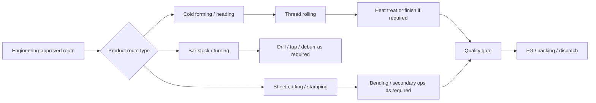
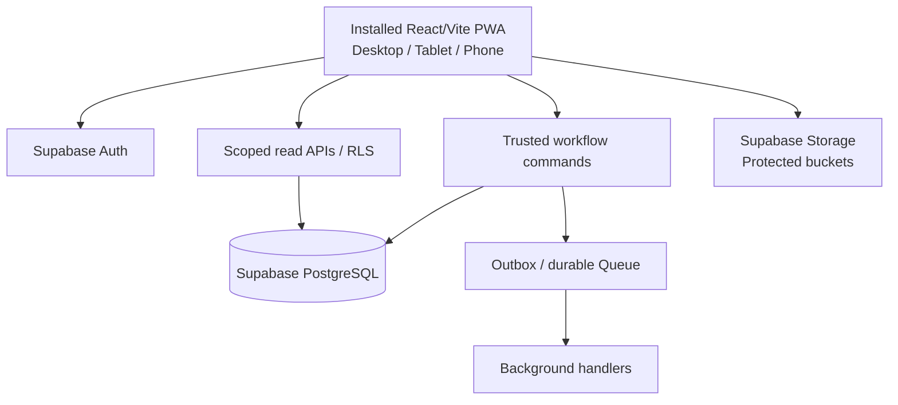

# Fastener Factory OS — Master Product Brief & Agent Startup Prompt

> **Document status:** Proposed implementation specification / prototype blueprint  
> **Version:** 0.1.0  
> **Prepared:** 2026-10-09  
> **Reference business:** Nitin Fasteners, https://www.nitinfasteners.com/  
> **Target delivery:** Internal, authenticated, installable Progressive Web App (PWA) for desktop, mobile and tablet.  
> **Core stack decision:** **React + Vite + TypeScript, not Next.js**, with Supabase as the backend.  
> **Decision status:** Architecture is a recommendation; specific factory practices are **not verified** until discovery.
>
> **Historical proposal:** The startup prompt and documentation matrix below are retained as design history.
> `AGENTS.md` is the sole current engineering contract, with an identical `CLAUDE.md`; use `adr/`, not
> `docs/decisions.md`. Current implemented scope is explained in `docs/product.md`, `docs/design.md` and
> `docs/architecture.md`. Proposed offline drafts, hardware and factory SOP are not implemented facts.

---

# PART A — COPY-PASTABLE STARTUP PROMPT FOR ANY CODING AGENT

**Copy the entire following instruction into your coding agent.** It is intentionally a standing operating contract rather than a demand to build the entire ERP in one response.

```text
You are the lead architect and implementation agent for Fastener Factory OS, an internal manufacturing ERP prototype inspired by the workflows of a fastener / precision-components manufacturing company, Nitin Fasteners.

Your first and canonical source of product intent is FASTENER_ERP_MASTER_BRIEF.md. Read it completely before coding. Treat business workflows in this document as design candidates until confirmed by factory discovery; never claim that unverified steps are real company SOPs.

THE GOAL:
Deliver an end-to-end, modular, audit-ready, installable PWA covering sales enquiry through manufacturing, inventory, quality, packing and dispatch. Design the core so that future Electron and React Native clients can consume the same backend APIs, but DO NOT build Electron or React Native now. This is a non-AI product; all workflows use configured rules and authorized server commands.

DECIDED STACK:
- React + Vite + TypeScript (strict mode); do not introduce Next.js.
- Tailwind CSS + shadcn/ui and accessible component primitives.
- React Router for routes; TanStack Query for server state; Zustand only for local UI state that genuinely needs global scope.
- vite-plugin-pwa/Workbox for installability, update handling and controlled offline experiences.
- Supabase PostgreSQL, Auth, RLS, Storage, Realtime where justified, SQL migrations and Edge Functions.
- PostgreSQL transactional functions (RPC) or equivalent trusted server-side transactional commands for critical inventory, production, QC and dispatch transitions.
- Zod at client and server ingress boundaries; database constraints for final enforcement.
- Background task queue for durable asynchronous work; use Supabase Queues/Cron initially where they fit and idempotent workers for processing. Verify current Supabase docs before implementation.
- Do not add a heavyweight Node.js backend unless concrete requirements exceed the Supabase capabilities; document the architectural decision first.

MANDATORY DOCUMENTATION CONTRACT:
1. Create AGENTS.md in the repository root as the canonical instruction document for every coding agent. It must contain the operating rules below and links to current docs.
2. Create CLAUDE.md in the repository root with `Read AGENTS.md first; AGENTS.md is canonical.` Add Claude-specific instructions only if genuinely required; avoid duplicating conflicting rules. If another tool uses a different agent instruction filename, make it link to AGENTS.md.
4. Maintain docs/tasks/TASKS.md as the human-readable task board. Create focused task specs in docs/tasks/TASK-####-slug.md. Every task has goal, scope, dependencies, risks, acceptance criteria, tests, owner/agent, status, and changed files.
5. For each meaningful feature or migration: read relevant documentation and current code → update/create task → note acceptance criteria → implement → test → update docs and diagrams → mark task done. NEVER mark a task complete without reporting validation evidence.
6. Keep docs/architecture.md in sync with actual modules, schemas, data flow, trust boundaries, runtime deployments and major decisions. Architecture diagrams may use Mermaid.
7. Keep docs/style.md in sync with actual interface tokens, responsive breakpoints, installed-PWA behaviors, typography, color/status semantics, interaction patterns and accessibility rules.
8. Log decisions to docs/decisions.md as numbered ADRs with context, options, decision, consequences, date and verification status. If a major decision changes, supersede the ADR rather than silently rewriting history.
9. Keep code and documentation aligned. Changes that invalidate docs require doc updates in the SAME pull request/task.
10. Use explicit labels for discovery assumptions: VERIFIED FROM FACTORY / VERIFIED FROM PUBLIC SOURCE / INDUSTRY PATTERN / DESIGN PROPOSAL / OPEN QUESTION. Never treat a proposed manufacturing route as Nitin's confirmed practice.

WORK EXECUTION RULES:
- Before editing, inspect current repository, AGENTS.md, related docs, migrations and task board. State a small implementation plan with files affected and test plan.
- Work in small vertical slices, not a huge untested scaffold. Prefer one working enquiry-to-order slice before building 16 inert screens.
- Never silently alter agreed product constraints or introduce unrelated libraries. When a tradeoff appears, document it with a short ADR.
- Define module-owned commands and data contracts. Never let components directly perform arbitrary multi-table writes for core business transitions.
- Enforce authorization in the backend and database, not only by hiding buttons.
- Use explicit transaction boundaries and concurrency tests for reservation, issue, receipt, rework, lot release and dispatch; reject negative stock unless explicitly authorized as an audited exception.
- Sensitive documents must be tenant/company scoped. Use RLS, least-privilege grants, protected storage buckets, safe token handling, structured logs without secrets and an append-only audit trail.
- Do not claim offline transactions are committed until the server confirms them. For the prototype, offline supports app shell/read-only cached screens and explicit drafts; stock and QC changes require connectivity.
- Design for scanner/touch workflows: few taps, large hit targets, clear confirmation, error recovery, barcode/QR entry, predictable statuses.
- Do not fabricate Nitin-specific product data, machines, suppliers, customers, rates, QC criteria or schedules. Use clearly marked SAMPLE data in development and demo.
- Pin dependencies/commit lockfiles. Check current official documentation for dependency and Supabase security changes before implementation.
- Run typecheck, lint, tests, relevant integration/E2E tests and migration validation. Report pass/fail honestly and fix failures before calling a task done.
- Do not deploy to real factory, connect production ERP, send real customer emails/WhatsApp, or submit legal/tax documents without authorization.

STARTUP PROCEDURE:
1. Read this file fully. Summarize confirmed requirements, proposed assumptions and unresolved discovery questions.
3. Generate the implementation roadmap as milestones and granular tasks. Build one vertical slice at a time.
4. Start with repository tooling, auth/RBAC/RLS, organization settings, core master data and the order thread. Then connect one end-to-end happy path using sample data before deepening modules.
5. Present the next smallest task with acceptance criteria and test evidence. Only implement code when asked to proceed or when the user explicitly delegates implementation.

This is a manufacturing operations application, not a marketing website. Favor operational clarity, accurate transaction state, traceability, recoverability and testability over decorative animations.
```

---

# PART B — PRODUCT VISION, SCOPE, LIMITS

## B1. Product definition

**Working name:** Fastener Factory OS (placeholder; not a verified brand name). A private, internal ERP for small-to-mid-sized fastener and precision-component manufacturers. It digitizes the complete order thread from sales contact to dispatch with configurable manufacturing routes, inventory and traceability, and deterministic workflow controls.

**Success means a manager can answer, from actual records:**
- What did the customer ask for, and which approved quotation/PO/drawing revision controls this job?
- Can we make it, with which route, BOM, tools, machines and capacity?
- How much raw material is physically present, available, reserved, quarantined, incoming, issued or held at a subcontractor?
- Where is each quantity of work-in-progress (WIP), and who last moved it?
- Which inspection records, measuring instruments, material lots and production operations produced each finished lot?
- Which jobs, material shortages, QC issues and supplier dependencies threaten promised dates?
- What has been packed, dispatched, received and invoiced?

## B2. Public research basis and discovery boundary

The referenced company publicly lists fasteners, machine screws, brass cable glands, brass neutral links, brass terminals, brass inserts, and sheet-metal components; it also describes precision-turned manufacturing and custom specifications. These facts justify a **multi-route product model**. The site does **not** prove its actual internal workflow, equipment list, subcontracting practices or software infrastructure.

References (public source pages):
- https://www.nitinfasteners.com/
- https://www.nitinfasteners.com/quality.html
- https://www.nitinfasteners.com/brass_cable_glands.html
- https://nitinfasteners.com/fasteners.html

Research/implementation references (verify current versions before coding):
- https://vite.dev/guide/
- https://vite-pwa-org.netlify.app/guide/
- https://supabase.com/docs/guides/database/overview
- https://supabase.com/docs/guides/database/functions
- https://supabase.com/docs/guides/database/secure-data
- https://supabase.com/docs/guides/functions
- https://supabase.com/docs/guides/queues
- https://reactrouter.com/start/modes

## B3. Scope

**Prototype in scope:** Internal authentication, roles, customer/supplier/item master, drawing revisions, RFQs, feasibility, cost sheets, quotes, PO checks, sales orders, planning, BOM and routing, material ledger/reservations, purchasing/GRN, QC, work orders/job cards, WIP, subcontract tracking, assembly when needed, FG release, packing, dispatch, audit, dashboards, installable PWA for all target devices.

**Prototype out of scope unless newly approved:** Native Electron app, React Native app, full public ecommerce/SEO site, direct machine/PLC control, unvalidated vision-based accept/reject, production accounting/tax filing, autonomously placing orders or changing inventory, unrestricted offline inventory mutations, multi-company conglomerate complexity, full HR/payroll.

**Adjacent extension modules:** Sales forecasting, accounting/AR/AP, quotation follow-ups, credit controls, customer complaints and returns, calibration, toolroom, preventive maintenance, production costing, document management, approvals, exports, certificates/PPAP, vendor scorecards, machine telemetry, OEE, energy use, external customer/vendor portals. Their exact phase is to be determined.

## B4. Guiding principles

1. **One data model; many surfaces.** Role-appropriate desktop, mobile and tablet interfaces share trusted business APIs.
2. **Routing rather than a rigid conveyor belt.** Each SKU revision/order chooses its route and required operations.
3. **Everything is traceable.** People, timestamps, quantities, units, revisions, lots, approvals and reasons.
4. **Workflow exceptions are first-class.** Holds, shortages, split lots, partial shipments, scrap, rework, corrections and cancellations.
5. **Deterministic operational truth.** Ledger/constraints/transactions determine commitments and stock balances.
7. **Installed app experience on all devices.** No separate mobile website experience is designed; installation is the intended flow.
8. **Prototype does not claim regulatory compliance or operational suitability until validated.**

---

# PART C — USER ROLES AND APP SURFACES

## C1. Roles (proposed)

- **Admin / IT:** identities, permission grants, plant/company settings, feature flags, integrations.
- **Management:** cross-functional overview and approved escalations.
- **Sales:** enquiries, customers, quotations, PO matching, order follow-up.
- **Engineering:** drawings, item revision, BOMs, routings, feasibility and technical signoff.
- **Costing/Commercial:** costing, approval thresholds, price history.
- **Planning:** MRP, capacity, schedule, work-order releases.
- **Purchase:** requisitions, vendors, POs, inbound follow-ups.
- **Stores/Warehouse:** receiving, locations, picks, reservations, transfers, returns, counts.
- **Production supervisor:** dispatch job cards to cells/operators, record downtime/issues.
- **Machine operator:** assigned job actions, quantity/downtime/material requests; minimum-privilege interface.
- **Quality inspector / lead:** inspection plans, measures, holds, NCRs, release signoffs.
- **Subcontracting coordinator:** outside processing and vendor material reconciliation.
- **Packing / Dispatch:** carton labels, verification, shipment/gate-out.
- **Accounts (later):** invoice reference, ledger export, payments/credit holds.
- **Auditor/read-only:** approved scoped access to records and history.

A user can carry multiple roles. Authorization is permission-based (action + resource + scope), not only role-name checks. Implement an auditable approval matrix; prevent self-approval for sensitive actions where required by adopted SOPs.

## C2. Installed PWA surfaces

| Device | Intended surface | Priorities |
|---|---|---|
| Desktop/laptop installed PWA | Full office ERP | dense tables, search, keyboard shortcuts, detail drawers, multi-column reports |
| Tablet installed PWA | Shop-floor app | large targets, barcode scan, clear job state, controlled quantity entry, gloves-friendly spacing |
| Phone installed PWA | Warehouse, management and approvals | scanning, receiving, picking, issue, notifications, approval inbox, KPIs |

**Important installation rule:** When phone/tablet users open the URL in a browser, show a clearly designed install/onboarding experience first. After installation, display the app in standalone mode. Some browsers/platforms cannot expose a universal install API or reliably prove installation; do not pretend install-only behavior is a security control. Access is protected by Supabase Auth and authorization regardless of browser display mode. Desktop installation should be supported too. 

**Offline prototype contract:** app shell and selected non-sensitive read-only cached data; clearly labeled unsent drafts can be locally edited. Server-side actions (reserve material, approve QC, issue stock, close job, dispatch) are online-only and must display confirmation of committed server state. Future approved offline write strategy requires queued signed operations, conflict handling, replay/idempotency and a separate ADR.

---

# PART D — THE 16-STAGE CANONICAL BUSINESS BACKBONE

This is a business navigation hierarchy, **not a rule that every order completes each stage in sequence**. Certain streams run concurrently. Requirements change by product, stock availability, manufacturing route and approvals.

| # | Major stage | Main artifact | Typical responsible role | Primary gate |
|---|---|---|---|---|
| 01 | Sales / enquiry | RFQ | Sales | Sufficient customer requirement |
| 02 | Technical / feasibility | Feasibility review | Engineering | Revision-approved technical route |
| 03 | Costing / quotation | Cost sheet + quote | Commercial | Approved price/terms |
| 04 | Order acceptance | PO reconciliation + SO | Sales/Management | Customer commitments approved |
| 05 | Planning | Production plan + WO | Planner | Feasible release plan |
| 06 | Material readiness | MRP / reservation / kit | Stores/Purchase | Correct usable materials available |
| 07 | Tooling / machine readiness | Setup clearance | Production/Toolroom | Equipment, tooling and gauges ready |
| 08 | Production execution | Job card | Operator/Supervisor | Recorded output and operation completion |
| 09 | WIP / movement | Movement events | Stores/Production | Custody and quantity reconciled |
| 10 | Quality control | Inspection / NCR | Quality | Applicable QC accepted |
| 11 | External / job work | Subcontract order | Vendor coordinator | Outside processing reconciled and inspected |
| 12 | Assembly / secondary ops | Assembly / secondary job | Production | Applicable operation completed |
| 13 | Finished-goods release | FG lot/release | QC/Stores | Finished material available for sale |
| 14 | Packing | Packing batch/cartons | Packing | Verified counts, labels and lot mapping |
| 15 | Dispatch planning | Shipment plan | Dispatch | Carrier, allocation and paperwork ready |
| 16 | Dispatch | Gate-out / shipment | Dispatch | Validated shipment confirmation |

## Stage 01 — Sales / Enquiry

**Entry:** Sales call, email, customer RFQ, drawing, sample, WhatsApp via permitted integration, repeat-order request.  
**Data:** customer/contact, source, requested product or specification, quantity + unit, due date, destination, drawing reference/revision, grade, finish, packaging, enquiry attachments, terms, owner and next action.  
**Substeps:** log interaction → normalize requirements → identify existing item/customer → collect missing details → attach drawings/samples → classify (standard/repeat/new development) → request technical review or quote.  
**States/tags:** `NEW`, `AWAITING_INFO`, `REVIEW_REQUIRED`, `QUALIFIED`, `LOST`, `DUPLICATE`; `URGENT`, `EXPORT`, `CUSTOM_DRAWING`.  
**Workflow:** form, templates, follow-up SLA, duplicate candidates, customer history and item lookup.
**Exceptions:** incomplete specification, conflicting attachments, customer identity ambiguity, revised RFQ and duplicate enquiry.  
**Exit:** approved requirements snapshot and RFQ version.

## Stage 02 — Technical / Feasibility

**Data:** drawing/part revision, material/grade, standards, dimensions/tolerances, processes, route, required gauges/tooling, capacity estimates, inspection plan, trial/sample approval if required.  
**Substeps:** version drawing → compare item candidates → classify make/buy/subcontract → select/propose BOM and routing → check capability/tooling/gauges → identify critical features → decide feasibility and conditions.  
**States:** `ENGINEERING_PENDING`, `UNDER_REVIEW`, `INFO_REQUIRED`, `FEASIBLE`, `CONDITIONAL`, `NOT_FEASIBLE`.  
**Workflow:** engineer workflow, revision-controlled specifications, approved routings/templates.
**Exceptions:** different drawing revisions, obsolete parts, tool development required, unapproved customer deviation.  
**Exit:** signed feasibility review or documented rejection.

## Stage 03 — Costing & Quotation

**Data:** material usage and yield, current/material vendor prices, route operations and run times, setup, labor/work-centre rates, tooling amortization, scrap assumption, subcontract charges, freight/packing, overhead, tax/terms placeholders, margin and revision.  
**Substeps:** calculate BOM → estimate yields → add operations/tooling/subcontracting → apply rate/version → check MOQ and price approval → build quote → send and follow up → version negotiation.  
**States:** `COSTING`, `NEEDS_RATE`, `APPROVAL_REQUIRED`, `APPROVED`, `SENT`, `REVISION_REQUESTED`, `WON`, `LOST`, `EXPIRED`.  
**Workflow:** formula engine and margin thresholds, comparable quote records, PDF generation.
**Exceptions:** price validity, material rate change, quantity breaks, revised drawing, rejected margin.  
**Exit:** revision-controlled approved quotation.

## Stage 04 — Order Acceptance

**Data:** customer PO, accepted quote, product/drawing revision, schedule lines, price and UOM, delivery location, customer-specific requirements, packing, terms/credit/approvals.  
**Substeps:** import PO → compare PO and quote line by line → resolve mismatches → credit/contract check → confirm dates → snapshot specifications → create Sales Order + delivery lines.  
**States:** `PO_RECEIVED`, `MATCHING`, `DISCREPANCY`, `ON_HOLD`, `APPROVED`, `ORDERED`, `CANCELLED`.  
**Workflow:** manual entry, rule-based comparison and approval.
**Exceptions:** customer price differs, earlier delivery requested, changed revision, duplicate PO, partial amendment.  
**Exit:** released/approved Sales Order.

## Stage 05 — Planning

**Data:** SO demand and due dates, on-hand/projection, WIP, routing version, capacity calendars, machine/work-centre, shift, setup times, batch policy, material lead times, vendor turnaround and order priority.  
**Substeps:** demand explosion → stock/FG netting → decide stock issue vs production → BOM explosion / MRP → capacity check → group/split lots → create job routes and WO → schedule operations → release when gates pass.  
**States:** `UNPLANNED`, `MRP_PENDING`, `CAPACITY_CONFLICT`, `TENTATIVE`, `PLANNED`, `RELEASED`, `REPLAN_REQUIRED`.  
**Workflow:** deterministic MRP and finite-capacity constraints/rules/optimization.
**Exceptions:** machine breakdown, alternate resource, partial FG stock, expedited order, missing capacity.  
**Exit:** versioned production plan, reserved demand and releasable work orders.

## Stage 06 — Material Readiness

**Data:** item variants; UOMs and conversion factors (pcs, kg, bundles, boxes); warehouses/zones/bins; inventory lots/heats; source certificates; physical/available/reserved/QC-hold/WIP/vendor balances; PO and GRN; BOM issue policy; kitting.  
**Substeps:** gross requirement → on-hand by location/lot → subtract holds/reservations → expected inbound check → shortage planning → requisition → supplier PO → follow-up → arrival/count/weigh → GRN → incoming QC → lot/batch certification → put-away → reserve/pick → kit → issue to WO → machine staging → unused return/scrap reconciliation.  
**States:** `NOT_CHECKED`, `SHORT`, `ON_ORDER`, `RECEIVED_QC`, `AVAILABLE`, `RESERVED`, `PICKED`, `KIT_READY`, `ISSUED`; flags `LOT_BLOCKED`, `EXPIRY/CERT_HOLD`, `UOM_MISMATCH`.  
**Workflow:** ledger, allocation rules, procurement and QR scans; all stock math is deterministic.
**Exceptions:** substitute materials requiring approval, rejected GRN, backflush discrepancies, excess issue, multi-lot kit, partial reservation, ownership/customer-owned material.  
**Exit:** verified material release for the operation/job; record all partials and shortages.

## Stage 07 — Tooling & Machine Readiness

**Data:** work centre, machine, operator qualification where applicable, die/tool/fixture/gauge, calibration, availability, maintenance block, tool life/counter, setup checklist, recipe/setup sheet.  
**Substeps:** reserve machine/time → confirm tooling/gauges → check calibration/maintenance → stage equipment → setup → trial/first-piece QC gate if applicable → release.  
**States:** `UNASSIGNED`, `TOOL_MISSING`, `MAINTENANCE_HOLD`, `SETUP`, `FIRST_PIECE_QC`, `READY`.  
**Workflow:** asset master, counters, setup checklists, due-date blocks.
**Exceptions:** lost/broken gauge, expired calibration, unscheduled breakdown, different tool revision.  
**Exit:** signed readiness gate.

## Stage 08 — Production Execution

**Data:** WO, job card, operation, work centre, scheduled and actual time, operator, lot, material issued/consumed, machine count, good/reject/rework qty, reason/downtime, setup changes, QC requests.  
**Substeps:** operation queue → setup → start → input lot/material checks → process work → capture output/defects/time → in-process check → complete partial/full → close/transfer WIP.  
**States:** `QUEUED`, `SETUP`, `RUNNING`, `PAUSED`, `BREAKDOWN`, `QC_WAIT`, `PARTIAL`, `COMPLETE`, `ABORTED`.  
**Workflow:** shop-floor touch UI, event timestamps, barcode scans, controlled quantity entries.
**Exceptions:** split job, material short issue, rework loop, scrap, operation skip by authorized deviation, shift handoff.  
**Exit:** validated operation output with full custody/quantity records.

## Stage 09 — WIP & Movement

**Data:** current holder/location, parent/child lots, from/to stages, transfer number, work-centre move, accepted/rejected/rework quantities, handler, time.  
**Substeps:** propose move → confirm lot and available quantity → authorize source → scan destination → receive/acknowledge → reconcile quantity and custody.  
**States:** `AT_STATION`, `IN_TRANSFER`, `AT_QC`, `AT_VENDOR`, `ON_HOLD`, `RECONCILIATION_REQUIRED`.  
**Workflow:** movement ledger and scans.
**Exceptions:** misplaced lot, partial receipt, serial/lot split, loss/damage, double scan.  
**Exit:** immutable movement transaction and current location projection.

## Stage 10 — Quality Control

**Data:** inspection stage, plan/version, sample size/rule, spec limits, measurements with units and instruments, images/certificates, lot/operation, inspector, acceptance evidence, NCR/CAPA and disposition.  
**Substeps:** incoming → first-piece → in-process → post-subcontract → final → pre-dispatch when applicable; run checks; accept/hold/fail; NCR → investigation → sort/rework/scrap/concession with approvals → re-inspection.  
**States:** `INSPECTION_DUE`, `IN_PROGRESS`, `PASS`, `HOLD`, `FAIL`, `NCR_OPEN`, `REWORK`, `CONCESSION_PENDING`, `RELEASED`.  
**Workflow:** criteria rules with controlled precision/tolerances, audit and release permissions.
**Exceptions:** out-of-tolerance measurements, invalid gauge, sample failure, concession approval, supplier certificate mismatch, QC lot hold.  
**Exit:** signed approved disposition; rejected material cannot silently enter available FG.

## Stage 11 — External / Job Work

**Data:** subcontractor, work order, operation, owner of raw/WIP materials, dispatch challan, sent/acknowledged/returned/lost quantities, turnaround promise, processing charges and certificate, inspection.  
**Substeps:** select approved vendor → issue subcontract order → reserve/transfer WIP → gate-out to vendor → acknowledge → receive progress/ETA → return → count/weigh reconciliation → QC → post charges → continue route.  
**States:** `REQUESTED`, `AWAITING_SEND`, `SENT`, `AT_VENDOR`, `LATE`, `PARTIAL_RETURN`, `RETURNED`, `QC_HOLD`, `CLOSED`.  
**Workflow:** vendor custody stock, expected dates, alerts and reconciliation.
**Exceptions:** partial return, shortage/loss, mixed lots, late job, defective coating/processing, rejected invoice.  
**Exit:** accepted outsourced output or controlled discrepancy resolution.

## Stage 12 — Assembly / Secondary Operations

**Activation:** Only if routing requires it; not a mandatory step for all SKUs.  
**Data:** parent/child items, assembly BOM, component lots, kit issue, torque/test or other required steps where appropriate, output lots.  
**Substeps:** check components → reserve → kit → issue → assemble or secondary-machine operation → inspect → output transfer.  
**States:** `NOT_APPLICABLE`, `AWAITING_KIT`, `RUNNING`, `TEST_REQUIRED`, `COMPLETE`, `HOLD`.  
**Workflow:** assembly BOM, backflush/manual issue, operation sequence and inspection.
**Exceptions:** missing component, substitute part, incomplete assembly, rejected output.  
**Exit:** approved semi-finished/finished item and component genealogy.

## Stage 13 — Finished-Goods Release

**Data:** completed output and disposition, all required QC and processing certificates, closed/open NCRs, FG lot ID, bin and released quantity.  
**Substeps:** reconcile operations → ensure routing gates satisfied → verify quantity by lot → verify certificates/QC → release approved quantity → transfer to FG location → allocate to SO.  
**States:** `PENDING_RECONCILIATION`, `QC_HOLD`, `RELEASE_PENDING`, `FG_RELEASED`, `FG_BLOCKED`.  
**Workflow:** transaction checklist and server-side release gate.
**Exceptions:** partial-release, disputed WIP, missing certificate, blocked lot, traceability gap.  
**Exit:** sellable FG lot with parent genealogy and audit.

## Stage 14 — Packing

**Data:** order/lot allocation, pack specification/version, units per carton/bag, net/gross weight, label template, box sequence, packaging material, scanner verification.  
**Substeps:** pick FG → scan correct lot/customer/order → choose pack instruction → count/weigh → pack → label → validate quantity → generate packing list → stage shipment.  
**States:** `WAITING`, `PICKED`, `PACKING`, `PARTIAL`, `PACKED`, `VERIFIED`, `HOLD`.  
**Workflow:** barcodes, printing, validations and reconciliation.
**Exceptions:** packing shortage, overpack, mixed lot prohibited, wrong label, damaged carton.  
**Exit:** identified package IDs linked to lots/order lines.

## Stage 15 — Dispatch Planning

**Data:** eligible packed goods, promised delivery, ship-to, carrier, serviceability, weight/volume, documents, vehicle/gate appointment, delivery groups.  
**Substeps:** gather ready order lines → split/consolidate shipments → choose carrier/route → allocate cartons → prepare docs → approve dispatch → set loading schedule.  
**States:** `NOT_READY`, `PARTIAL_READY`, `DOC_HOLD`, `CARRIER_PENDING`, `READY_TO_LOAD`, `READY_TO_DISPATCH`.  
**Workflow:** scheduling/route optimization where useful; packing and invoice references.
**Exceptions:** partial dispatch, carrier cancellation, customer hold, document mismatch.  
**Exit:** approved shipment with confirmed source cartons and transport details.

## Stage 16 — Dispatch

**Data:** shipment ID, sales-order lines, cartons/weight/count, lot genealogy, gate-out event, vehicle/driver/carrier, invoice/e-way documents if applicable, acknowledgement/PoD later.  
**Substeps:** verify loading → scan packages → reconcile dispatch quantity → finalize docs → supervisor/gate approval → gate-out → customer notification → subsequent delivery/PoD and close.  
**States:** `LOADING`, `COUNT_MISMATCH`, `GATE_APPROVAL`, `DISPATCHED`, `IN_TRANSIT`, `DELIVERED`, `CLOSED`, `DELIVERY_EXCEPTION`.  
**Workflow:** transactional gate-out, audit and shipment tracking.
**Exceptions:** short-loaded carton, wrong vehicle, partial ship, missing mandatory documents, return to warehouse, delivery refusal.  
**Exit:** immutable dispatch event with confirmed quantity, packaging IDs and corresponding lot record.

---

# PART E — ROUTES, ORDER TYPES AND PARALLEL PATHS

The 16-stage backbone is a navigational mental model. Build **separate state machines per object**, not a single `orders.status` enum trying to express all factory facts. A single SO may have two active WOs, one partial FG allocation and two shipments.

## E1. Order archetypes

1. **Make-to-stock / finished stock:** enquiry/quote/SO → reserve accepted FG → packing/dispatch; manufacturing optional.
2. **Repeat make-to-order:** known item and approved routing/BOM → PO → planning/material/production → ship.
3. **New engineering-to-order:** drawing intake → feasibility, tool and route design, sampling/prototype/approval as needed → production.
4. **Custom batch with external processing:** operations include dispatch-to-vendor and return inspection.
5. **Customer-supplied material:** separate ownership and traceability; never mix with company-owned stock without documented policy.
6. **Assembly product:** kit multiple components then assembly/test.
7. **Partial delivery / split WO:** one SO can reserve multiple lots and create multiple shipments.
8. **Rework / rejection:** directed lot returns to an approved rework route; no silent change to a completed job card.
9. **Purchase-and-resell or job-work-only:** optional commercial variants, depending on validated business needs.

## E2. Example route templates — ONLY hypothetical patterns



Do not assume all these operations exist at Nitin. Each template is editable/approvable and versioned. Route operation types can be internal machine, external vendor, quality gate, material transfer, assembly or manual checkpoint. Dependency edges support parallel routes where meaningful; the scheduler must enforce real dependencies.

## E3. Quantity and unit model

- Explicit input/output UOM; decimal precision by item/process. Conversion between weight and pieces can depend on measured batch weight/standard weight; record source and variance.
- Separate `quantity_on_hand`, `reserved`, `on_qc_hold`, `issued_to_wip`, `at_subcontractor`, `available_to_promise`, `projected_inbound` as **derived views**, not independent mutable truth.
- Maintain material genealogy across splits, merges, reworks and packing; permit only validated combinations. Batch/heat and certificates are first-class.
- Never represent concurrent states (e.g., partially shipped + still in production) as a misleading single global order status. Use progress aggregates and warnings in the Order Command Center.

---

# PART F — SCREENS AND INFORMATION ARCHITECTURE

## F1. Office navigation

```
Home / Alerts
Sales: Enquiries, Customers, Quotes, Sales Orders
Engineering: Items, Drawings, Revisions, BOMs, Routings, Feasibility
Planning: Demand, MRP, Capacity, Work Orders, Schedule
Purchasing: Requisitions, Suppliers, POs, Expected Receipts
Inventory: Stock, Lots, Warehouses/Bins, Holds, Reservations, GRN, Movements
Production: Work Centres, Job Cards, Shift Board, Downtime, WIP
Quality: Inspection Plans, Inspections, NCR, Rework, Calibration
External Processing: Vendors, Job Work, Material at Vendor
Assembly (conditional): Assembly Jobs, Kits
Finished Goods: FG Lots, Allocations
Packing & Dispatch: Packs, Shipments, Gate-out, Delivery
Reports: Orders, OTIF, WIP, Scrap, Yield, Inventory Aging, Vendor KPIs
Documents / Audit
Settings: Users, Roles, Plants, Numbering, Units, Approvals, Flags
```

## F2. Role-specific home screens

**Sales:** RFQs awaiting info, quotes pending approval, POs with mismatches, orders at risk.  
**Planning:** bottlenecks, WO readiness, pending releases, shortages, capacity load.  
**Stores:** receive, GRN, scan bin, QC hold, pick, kit, issue, transfer, cycle count.  
**Operator:** next assigned work, start/pause, quantity in/out, downtime reason, request QC/material, completion.  
**QC:** inspection queue, critical lots on hold, NCR, release approvals.  
**Dispatch:** packed ready, documents hold, scan loading, release, gate-out.  
**Management:** promise risk, on-time delivery, throughput, rejection, inventory, cash/AR if enabled.

## F3. Order Command Center (required centerpiece)

Shows customer and sales terms; line products; all source documents/revisions; a split overview for commercial/material/production/QC/FG/dispatch; blocked actions and next owner; full timeline; direct links to objects, allocations, lots, and exception notes.

**UI status guidance:** `Draft`, `Pending approval`, `Blocked`, `In progress`, `Passed`, `Rejected`, `Completed`, `Cancelled`, `Overdue`. Store machine-readable states; display short readable labels. Separate `urgent` priority and `blocked` status, which are not interchangeable.

## F4. Search

Global search by SO, PO, RFQ, item code, specification, drawing revision, work order, lot/heat, GRN, supplier, customer, carton, shipment and scanned code. Permissions filter results. Hybrid full-text/fuzzy search first; no approximate lookup substitutes for exact lot/reference lookup.

---

# PART G — TECHNICAL ARCHITECTURE AND SUPABASE BACKEND

## G1. Technology decisions

| Concern | Chosen for prototype | Reason |
|---|---|---|
| Client | React + Vite + TypeScript (strict) | fast dev + static build; no SSR requirement |
| App install | vite-plugin-pwa / Workbox | manifest, service worker, update UX |
| Navigation | React Router | SPA nested routes; use data APIs only where appropriate |
| UI | Tailwind CSS, shadcn/ui | consistent primitives and rapid iteration |
| Remote data | TanStack Query | caching, loading, error and invalidation flows |
| Local UI state | Component state; Zustand sparingly | avoids parallel sources of business truth |
| Validation | Zod + SQL constraints | types at boundaries, schema at commit |
| Backend | Supabase | managed PostgreSQL, Auth, Storage, Realtime, Functions |
| Critical writes | PostgreSQL transactions/RPC via restricted command APIs | atomicity and concurrency, authoritative logic |
| Secrets/webhooks | Supabase Edge Functions | trusted integrations when needed |
| Background | Supabase Queues/Cron initially | durable retries, idempotent work |
| Reports | SQL materialized/normal views and aggregates | verifiable arithmetic |
| Telemetry | structured errors/audit and basic traces | diagnosis without overbuilding |
| Future | Electron, React Native | separate clients using same API/permissions |

Do **not** use Next.js or duplicate an app server solely to proxy every trivial authenticated query. Reconsider an independent backend (e.g. Fastify/NestJS) only with an ADR and a demonstrated need for long-running CPU-intensive processes, industrial edge device services, complex orchestrations or integration limits.

## G2. Architecture overview



**Command boundary:** ordinary authorized list/detail reads may query scoped Supabase APIs. Write commands that span entities or affect material, approvals, QC or shipment state must run as one validated server/database operation; validate role, transition, quantities, revisions and concurrency in that boundary.

## G3. Proposed database domains/tables

Names are an initial logical sketch, **not the final schema**. Normalize versions and ownership; migrations and ERD belong in `docs/domain-model.md`.

- `companies`, `plants`, `departments`, `profiles`, `memberships`, `roles`, `permissions`, `role_permissions`, `user_role_assignments`, `approval_policies`
- `customers`, `customer_contacts`, `suppliers`, `supplier_contacts`, `addresses`, `customer_terms`
- `items`, `item_variants`, `item_categories`, `uoms`, `item_uom_conversions`, `drawings`, `drawing_revisions`, `documents`, `document_versions`, `item_specifications`
- `bom_headers`, `bom_versions`, `bom_lines`, `routing_headers`, `routing_versions`, `routing_operations`, `routing_dependencies`, `work_centres`, `machines`, `tools`, `gauges`, `calibrations`, `maintenance_events`
- `enquiries`, `enquiry_lines`, `enquiry_interactions`, `feasibility_reviews`, `cost_sheets`, `cost_lines`, `quotations`, `quotation_lines`, `customer_purchase_orders`, `po_matching_issues`, `sales_orders`, `sales_order_lines`, `delivery_schedule_lines`
- `production_plans`, `demand_requirements`, `mrp_runs`, `mrp_recommendations`, `work_orders`, `work_order_materials`, `job_cards`, `job_card_events`, `job_card_outputs`, `downtime_events`, `production_scrap`, `operator_assignments`
- `warehouses`, `storage_locations`, `bins`, `stock_lots`, `lot_genealogy`, `stock_ledger_entries`, `stock_reservations`, `stock_counts`, `material_requests`, `material_request_lines`, `purchase_orders`, `purchase_order_lines`, `goods_receipts`, `goods_receipt_lines`, `material_issues`, `material_returns`, `movement_orders`
- `inspection_plans`, `inspection_characteristics`, `quality_inspections`, `quality_measurements`, `nonconformances`, `ncr_dispositions`, `rework_orders`, `quality_releases`, `quality_attachments`
- `subcontract_orders`, `subcontract_order_lines`, `vendor_stock_movements`, `subcontract_returns`, `subcontract_charges`
- `assembly_jobs`, `assembly_consumption`, `fg_lots`, `fg_allocations`, `packing_orders`, `packages`, `package_contents`, `shipment_plans`, `shipments`, `shipment_packages`, `shipment_events`, `delivery_confirmations`
- `activity_events`, `audit_log`, `domain_outbox`, `idempotency_keys`, `attachments`, `alerts`, `notifications`, `workflow_task_assignments`

**Stock design:** append-only inventory ledger with explicit movement types and signed quantities, unique idempotency key and reference, lot/location ownership and source/target. Rebuild snapshots/projections from ledger; use transactional checks and locks for concurrent stock allocations. Monetary fields use DECIMAL/NUMERIC with currency and precision, never JS floating-point alone for authoritative financial math. The same applies to precision-sensitive measurements.

**Tenant strategy:** even if initial deployment is for one factory, include `company_id` / scoped plant data in relevant rows and authorization policies so multiple plants or companies do not require rewriting everything. Do not implement an elaborate multi-tenant marketplace; just establish access boundaries.

**Revisions:** immutable approved BOM/routing/drawing versions. Each quote, SO and WO pins required version IDs; do not silently mutate historical job definitions when engineering publishes a new revision.

**State machines:** use separate validators for `rfq`, `quotation`, `sales_order`, `work_order`, `job_card`, `stock_movement`, `inspection`, `ncr`, `packing_order`, `shipment`. Events/timeline aggregate multiple active streams; not a single monolithic status field.

## G4. Command contracts

Example logical API interfaces (not literal deployed routes):

```ts
reserveMaterial({ workOrderId, itemId, lotId, locationId, quantity, unit, idempotencyKey })
issueMaterial({ workOrderId, reservationIds, destinationWorkCentreId, idempotencyKey })
recordProductionOutput({ jobCardId, inputLotIds, goodQty, rejectQty, reworkQty, unit, idempotencyKey })
submitInspection({ inspectionId, measurementRecords, disposition, expectedRevision, idempotencyKey })
releaseFinishedGoods({ outputLotId, approvedQty, expectedInspectionRevision, idempotencyKey })
verifyPacking({ packOrderId, packageBarcodes, idempotencyKey })
confirmDispatch({ shipmentId, scannedPackageIds, vehicleData, documentRefs, idempotencyKey })
```

Each command checks authentication, authorization, current versions, permissible transitions, available quantities, unit conversion, source/destination, and duplicate requests; commits atomically with auditable domain events. Return structured errors (`INSUFFICIENT_AVAILABLE_STOCK`, `LOT_QC_HOLD`, `INVALID_TRANSITION`, `REVISION_CONFLICT`) that the UI can explain without guessing.

## G5. Supabase security baseline

- RLS on exposed tables; role/plant/company scope in policies; both grants and RLS matter.
- Secret/service-role keys never shipped in browser code or `VITE_*` env variables.
- Do not authorize based on user-editable metadata; store permission claims in protected data.
- Protected Storage buckets and signed/authorized document access; prevent leaking drawings between companies/customers.
- Use SQL functions with least privilege; prefer `SECURITY INVOKER`; isolate/restrict functions needing elevation and verify authorization inside.
- Validate JWT/user identity and permissions inside Edge Functions. Do not assume client-provided IDs are safe.
- Audit who requested, approved or cancelled critical transitions and store before/after references. Protect append-only logs from normal-user modification.
- Backups/restores and migration rollbacks must be tested before any production use.
- The prototype must never use real manufacturing or customer information without consent and proper access configuration.

## G6. Jobs, events and realtime

- Outbox/domain events: `RFQ_CREATED`, `QUOTE_APPROVED`, `SO_ACCEPTED`, `MATERIAL_SHORTAGE`, `STOCK_RESERVED`, `WO_RELEASED`, `JOB_PAUSED`, `QC_FAILED`, `LOT_RELEASED`, `PACK_VERIFIED`, `SHIPMENT_DISPATCHED`.
- Use queue worker for reminders, notifications, document parsing, PDF generation, cost analytics, risk scoring; at-least-once processing semantics should be assumed and consumer handlers must be idempotent.
- Realtime subscribe to targeted status and alert projections rather than every row across all tables. Query authoritative state after reconnect.
- Add metrics for duplicate commands, failed movements, slow APIs, blocked queues and orphaned jobs.

---

# PART I — APPROVALS, AUDIT, RELIABILITY, EXCEPTIONS

## I1. Proposed approvals

Price margin override, engineering deviation, drawing/BOM/routing release, material substitution, negative-stock override if ever allowed, unapproved vendor choice, QC concession, scrap disposition, rework release, FG release and shipment gate-out. Thresholds and authorized actors must be configurable, verified at discovery, and enforced server-side.

## I2. Audit model

Every sensitive event includes actor/user, role, company/plant, entity type/ID, correlation and causation IDs, previous/new state or references, timestamp, reason, request origin, device/session where useful, idempotency key, and affected lot/quantity. Maintain human-friendly timelines in UI and durable append-only audit behind them.

## I3. Critical exceptions

- Double-issued stock from concurrent scanners → lock/transaction, reject duplicate issue.
- QC hold placed on previously reserved lot → reservations become blocked and planner notified.
- Split WIP across machines/vendors → explicit child lots, quantity conservation rules.
- Revised customer PO after work starts → revision-impact process, not direct overwrite.
- Subcontractor returns fewer pieces than sent → discrepancy/NCR/vendor claim workflow.
- New drawing Rev D while Rev C WOs active → controlled engineering change; jobs pin versions.
- Incorrect operator quantity → reversal/correction event with permissions; never silently edit ledger.
- Offline/weak shop-floor network → no false success and explicit retry status.
- Staged goods loaded into wrong vehicle → shipment verification gate stops commit.
- Partial customer shipment → Sales Order remains partially fulfilled until all accepted obligations close.

---

# PART J — UI/UX STYLE CONTRACT (INITIAL; MOVE TO docs/style.md)

## J1. Design intent

**Industrial operations dashboard**, not a public marketing site. Clear, compact, quiet visual design with high readability and strong error states. Use a neutral base, clear typographic hierarchy, disciplined spacing, side navigation on desktop and task-driven navigation on mobile. Avoid decorative gradients, meaningless cards, excessive animations or tiny buttons on the factory floor.

## J2. Suggested primitives

- shadcn/ui-based forms, dialogs, tables, tabs, command palette, badges, toast feedback.
- Desktop tables: search, filter, save views, column visibility, keyboard navigation and expandable rows.
- Tablet/warehouse: card queues, touch-first scanner interaction, numerically optimized inputs, focus management, undo/confirmation when allowed.
- Semantic states independent of color: label + icon + status reason; never rely on red/green alone.
- Clear `Blocked because ...` explanations and visible owning department/person.
- Dates shown in configured plant timezone; persist UTC timestamps. Display units everywhere and never silently convert.
- WCAG-aware contrast and accessible labels; test on actual tablet/phone viewports.
- Report/timeline displays must include record ID, last update and source of truth.

## J3. Prototype layout rules

- Desktop: persistent navigation + header/global search + primary content + optional contextual drawer.
- Tablet: dedicated role interface, landscape-friendly but portrait responsive.
- Mobile: installed standalone workflow app for operational roles, minimal deep navigation.
- Installation/onboarding: branded install explanation, relevant browser instructions, post-install login and role routing. Website URL is the delivery/update origin but normal mobile-browser usage is not the target experience.
- Offline badge with explicit actions disabled and local-draft count; no green completion after an unconfirmed mutation.

---

# PART K — DOCS, AGENT COORDINATION AND TASK HYGIENE

## K1. Required repository skeleton

```
repo/
├── FASTENER_ERP_MASTER_BRIEF.md    # this source brief; changes by explicit decision
├── AGENTS.md                        # universal agent contract; canonical
├── CLAUDE.md                        # read/obey AGENTS.md; tiny Claude-specific guidance
├── README.md
├── package.json
├── pnpm-lock.yaml                    # or one selected lockfile; decide once
├── index.html
├── vite.config.ts
├── src/
│   ├── app/                         # providers, routes, shell
│   ├── features/                    # enquiry, sales, stock, production, qc, ...
│   ├── components/ui/               # design system primitives
│   ├── shared/                      # types, validation, general utilities
│   ├── lib/                         # api, supabase client, feature flags
│   └── pwa/                         # install/update/offline UI
├── supabase/
│   ├── migrations/
│   ├── functions/                  # trusted APIs
│   └── seed.sql                    # fake/demo only
├── docs/
│   ├── product.md
│   ├── architecture.md
│   ├── style.md
│   ├── domain-model.md
│   ├── workflows.md
│   ├── ai.md
│   ├── security.md
│   ├── testing.md
│   ├── decisions.md                # ADR index + records
│   └── tasks/
│       ├── README.md
│       ├── TASKS.md
│       └── TASK-0001-foundation.md
└── tests/
    ├── unit/
    ├── integration/
    ├── e2e/
    └── fixtures/                    # explicitly fictional data
```

## K2. Exact AGENTS.md policy

`AGENTS.md` must act as the **entrypoint for all agents**, with:

1. Product and architecture summary, plus link to this brief.
2. Rules about validated vs proposed factory processes.
3. Strict decided stack: Vite/React/TypeScript + Supabase; installed PWA; non-AI product; no Next.js.
4. Link index of `/docs` and ownership (architecture for system structure, style for UX, workflows for states, domain model for schema, security for trust boundaries, tasks for delivery status, decisions for ADRs).
5. Workflow: inspect → choose smallest task → define tests → code → validate → update docs → report.
6. Critical manufacturing transaction rules, RLS, idempotency, revisions, lot genealogy, concurrency and trusted command boundaries.
7. Code quality conventions, dependency policy, migration workflow, no fake completion claims, and no production external side effects without authorization.
8. Agent coordination: avoid concurrent edits to same feature/migration; each task declares affected files and interface contracts; integrate only validated work; reconcile architecture/DB changes centrally.
9. Definition of done and testing evidence.

`CLAUDE.md` should be:

```md
# Claude Agent Instructions

Read and obey [AGENTS.md](./AGENTS.md) before taking any action.
`AGENTS.md` is the sole canonical cross-agent instruction file.
Follow its documentation, architecture, test and task protocols.
Do not duplicate workflow rules here; keep Claude-specific notes minimal.
```

## K3. Documentation responsibility matrix

| File | Must contain | Update trigger |
|---|---|---|
| `docs/product.md` | user goals, roles, scope, key scenarios, success criteria | product decision or scope change |
| `docs/architecture.md` | C4-ish maps, deployed services, interfaces, module boundaries, data flow, ADR links | module/API/runtime/integration changes |
| `docs/style.md` | tokens, component rules, accessibility, responsive/installed-PWA behaviors, screenshots | visual/UI pattern changes |
| `docs/domain-model.md` | ERD, entities, UOM, status model, ledger/genealogy, invariants | migration/domain changes |
| `docs/workflows.md` | 16 stages, branches, permission gates, diagrams, examples | state transition or process change |
| `docs/security.md` | threat model, RLS, roles, secrets, storage and audit | auth, permission or data changes |
| `docs/testing.md` | strategy, command coverage, fixtures, CI and test evidence | test/tooling change |
| `docs/decisions.md` | ADRs including alternatives/reasons | every major architectural tradeoff |
| `docs/tasks/TASKS.md` | prioritized task list, owner, dependencies, status | every unit of work |

## K4. Task template

```md
# TASK-#### — Short outcome title
- Status: TODO | IN_PROGRESS | BLOCKED | IN_REVIEW | DONE
- Owner/agent:
- Related epic/milestone:
- Relevant docs / decision IDs:
- Depends on:
- Discovery status: VERIFIED / ASSUMED / OPEN

## Goal
## User-facing acceptance criteria
## In scope
## Out of scope
## Planned files/modules
## Data migration and authorization implications
## Test cases (happy, failure, concurrency as relevant)
## Implementation notes
## Validation evidence (exact command + result)
## Docs updated
## Follow-ups / risks
```

## K5. Definition of done

A feature is done only when: application runs; permission boundaries checked; success and failure paths demonstrated; domain invariants tested; types/lint pass; relevant migration applied/reverted on a clean test DB; user flow tested; docs updated; no fake data represented as real; no undocumented architectural divergence; task and ADR statuses consistent.

---

# PART L — ITERATIVE BUILD ROADMAP

## L0 — Factory discovery and mock data

- Interview sales, engineering, purchase, stores, planning, production, QC, toolroom, subcontract coordinator, packing and dispatch.
- Collect sanitized sample RFQ → quote → PO → WO → job card → QC → packing → dispatch documents (only with permission).
- Validate actual manufacturing routes, materials, UOMs, shifts, approvals, equipment, labels and bottlenecks.
- Create synthetic data and acceptance narratives that are unmistakably fictional.

## L1 — PWA foundation, security, docs

Vite/React/PWA install, Supabase local/project setup, migrations, authentication, role permissions and RLS, reusable app shell, sample fixtures, task/doc conventions. Deliverable: a signed-in role-based installable app with no unnecessary features.

## L2 — Master data and order thread

Customers, suppliers, items, specifications, drawing versions, warehouses, locations, tools, work centres, BOM/routing versions, globally searchable IDs, audit events and order command center skeleton. Deliverable: data and links across objects.

## L3 — First end-to-end order slice

RFQ → engineering review → cost/quote → PO match → SO → reserve existing accepted FG → packing → shipment. **First demonstrate a real vertical slice using fake data** rather than building 16 disconnected screens.

## L4 — Material operations

MRP foundation, PO/receipt/GRN, lots, QC holds, ledger, reservation, pick, issue, return, lot trace, barcode scanning, transactions and concurrency tests.

## L5 — Manufacturing execution

WO and route/operation scheduling, job cards, work-centre state, actual good/scrap/rework output, tool/gauge readiness, WIP movement and tablet UX.

## L6 — Quality and subcontracting

Incoming/first-piece/in-process/final QC, NCR dispositions, rework, external vendor custody/returns and certificates, FG release.

## L7 — Dispatch hardening and operational reports

Packing, labeling, shipment, gate-out, partial shipments, traceability backward/forward, exception board, read-only metrics.

## L8 — Documents, migration and approved accounting exports

Private drawing/certificate documents, validated master import, controlled numbering and deterministic exports to the existing accounting system. No tax filing until its document rules and authorization are approved.

## L9 — Advanced extensions after evidence

Scheduling recommendations, supplier risk, maintenance, additional finance integration, mobile/native/electron only if justified, industrial telemetry, experimental vision QC separately scoped.

---

# PART M — ACCEPTANCE SCENARIOS FOR INITIAL TESTING

1. **Standard FG order:** Create RFQ → quote → PO match → SO → reserve released FG → 2 boxes → pack/scan → dispatch; exact lot and carton trace afterward.
2. **Material shortage:** WO demands 100 kg usable, only 60 kg available; reserve 60, raise shortage for 40; cannot issue 100 until received/accepted.
3. **Concurrent reservation:** two clerks attempt the same lot; only valid available quantity commits and the loser gets a structured conflict.
4. **Failed incoming QC:** GRN receipt quarantined; cannot reserve from QC hold until authorized release.
5. **Split WIP:** one parent lot split into machine and vendor portions; each child traceable and conservation checks pass.
6. **Revision change:** Rev C WO released; Rev D introduced; historical WO continues pointing to Rev C unless approved change order applied.
7. **Rework loop:** 200 fail thread check; create NCR and 200-qty rework job; return to re-inspection before FG release.
8. **Partial delivery:** SO 10,000 pcs, 6,000 shipped, 4,000 outstanding; actual shipment and order availability remain correct.
9. **No internet:** shop-floor UI shows offline; attempt to record inventory move remains uncommitted with unmistakable status.
10. **Role denial:** machine operator cannot approve price overrides, engineering revisions or QC concessions through UI or API.
11. **Current inspection:** a passed inspection for an earlier lot revision cannot release returned or topped-up material.
12. **Production loss recovery:** a closed batch with recorded scrap frees only that lost demand for replacement work.
13. **Double scan:** submitting the same dispatch request twice uses idempotency to avoid duplicate stock reduction/shipment event.
14. **Vendor discrepancy:** issue 1,000 pcs to subcontractor, receive 990; ledger and discrepancy record accurately account for the missing 10.
15. **Order command center:** prove that sales, material, operation, QC, packing and dispatch sub-statuses can coexist rather than falsely collapsing to one field.

---

# PART N — METRICS AND BUSINESS CASE

**Baseline KPIs (definitions must be documented):** RFQ-to-quote time; quote hit rate; order-to-dispatch lead time; on-time-in-full (OTIF); work-order adherence; capacity utilization; WIP aging; scrap/rework rate; QC first-pass yield; supplier lead time; material shortage frequency; inventory adjustment frequency; dispatch errors; traceability lookup time; user time spent re-entering data.


**Cost buckets:** PWA hosting/static delivery, Supabase instance/storage/egress/realtime/functions/database backups, labels and scanners, implementation/support, domain/security, operational training and data migration. Verify live provider pricing before estimating INR budget. No pricing is asserted in this brief.

---

# PART O — REQUIRED FACTORY DISCOVERY QUESTIONS (UNVERIFIED TODAY)

Use these before turning the design into a real SOP:

1. Which products are stocked standard items vs repeat custom parts vs new drawings? Typical batch sizes and lead times?
2. What channels bring enquiries (calls, Excel, email, WhatsApp, portals)? Who currently creates quotes?
3. What is the current RFQ → drawing review → approval → PO workflow? Who can reject, override or change an order?
4. Which manufacturing steps and machine groups actually exist? For each product family, which are internal vs job work?
5. How do they plan machines/shift capacity and handle urgent jobs? What current register/Excel tracks the plan?
6. How do they calculate price, scrap, raw material usage and conversion between kg and pieces?
7. Which inventory locations, stock categories and purchase processes exist? Do they already track heat/lot and supplier certificates?
8. How do they physically move and identify WIP? Is weighing, batch tag, QR, barcode or handwritten register used?
9. How are QC plans, gauges, calibration, incoming/in-process/final inspection and concessions handled?
10. How is subcontract dispatch/return accounted for, including scrap/loss and vendor certificates?
11. Who releases finished goods, chooses packaging, creates documents, verifies gate-out and manages delivery proof?
12. What ERP/accounting software currently exists? Must historical data, GST invoices or e-way bill integration be preserved?
13. What are actual internet/wifi conditions on the shop floor and device preferences (desktop/tablet/Android/iPhone)?
14. Which steps are highest pain or error; how many orders, SKUs, users, daily movements and documents are involved?
15. What is the data-sharing policy, monthly operating budget and requirement for on-premises deployment?

**Do not hard-code any answers to these questions until validated.**

---

# PART P — DECISION REGISTER (INITIAL)

| ID | Decision | Status | Rationale / revisit condition |
|---|---|---|---|
| ADR-001 | React + Vite, not Next.js | PROPOSED-ACCEPTED BY DESIGN DIRECTION | Internal installed SPA; no needed SSR/SEO; revise if real server-rendering requirement appears |
| ADR-002 | Supabase Postgres/Auth/Storage backend | USER PREFERRED / DESIGN DEFAULT | Fast integrated prototype; validate scale/operations/security against factory needs |
| ADR-003 | Installed PWA for desktop, phone, tablet | USER DIRECTIVE | No native Electron/React Native in prototype |
| ADR-005 | Append-only stock ledger and transactional commands | DESIGN RECOMMENDATION | Needed for traceability and concurrent accuracy |
| ADR-006 | 16 stages as navigational backbone; separate domain state machines | USER APPROVED BACKBONE / DESIGN DETAIL | Handles parallel work, alternate routes and partial orders |
| ADR-007 | Online-only mutation for critical operations in prototype | DESIGN RECOMMENDATION | Offline reconciliation complex and risky; validate actual connectivity |
| ADR-008 | AGENTS.md canonical; CLAUDE.md delegates to it | USER REQUEST / DESIGN DETAIL | Prevent divergent agent instructions and inconsistent docs |

---

## End condition for initial agent session

After reading this document, the coding agent should **not** attempt to code the full ERP in one pass. It should initialize agreed documents, expose uncertain factory assumptions, propose the first small vertical slice with tests, and then implement iteratively as directed. Everything built must remain coherent with the 16-stage business backbone, multi-route manufacturing model, installed-PWA-only product intent for mobile/tablet, Supabase authoritative backend and deterministic command architecture.
