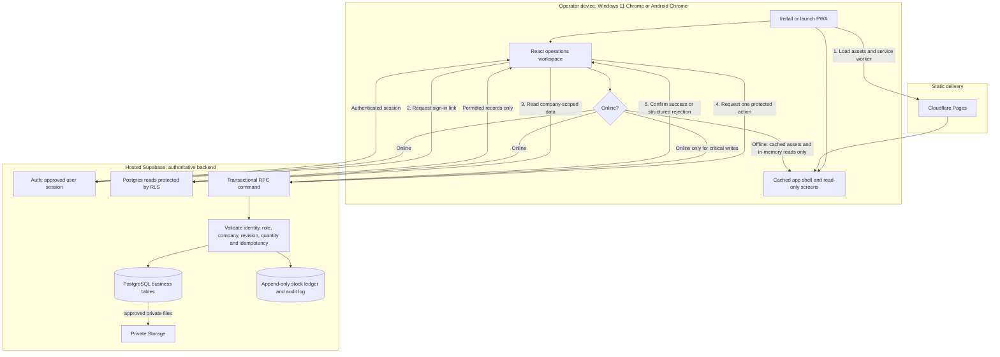

# Fasteners Factory ERP

An authenticated, installable operations ERP for a fastener or precision-component factory. It is a React PWA with Supabase as its complete backend, designed for Windows 11 Chrome and Android Chrome first.

> **Project status:** generic non-AI factory workflows through L9 are implemented and automatically tested with fictional SAMPLE data. Live factory rollout still requires actual configuration, device evidence, operations secrets and production restoration acceptance.

## What it does today

Commercial RFQ/line feasibility/quote/order; approved engineering and specifications; split supplier POs and partial held
receipts; signed stock/reservation/count/split/merge events; bounded production/jobs/WIP/output; configured QC/NCR/rework;
vendor custody; private drawings/certificates; actual lot packages/partial dispatch/customer returns; customer part
references; measured alternate units; paged reports/history; staff access/audit; validated imports/accounting snapshots;
equipment calibration/maintenance and explicit shifts/capacity. Shared scanner/Code 39 labels open exact permitted records.

No AI, public signup, offline stock queue, machine/PLC control, general ledger/GST filing, payroll or direct Tally sync.
SAMPLE configuration is not a factory SOP. Hardware baseline is keyboard-wedge input and browser printing; physical
readability and installed OS behavior remain acceptance work. See [design](docs/design.md) and [manual](docs/user-manual.md).

## Architecture



### How the system behaves

1. **Open and authenticate.** The installed app loads its static shell from Cloudflare Pages. An existing approved user requests a passwordless Supabase sign-in link. Until the session is confirmed, operations data stays unavailable.
2. **Choose a company and work with current records.** The browser uses the session to request company-scoped dashboard counts, search results, master data, lots, and workflow records. RLS filters every read at the database; the browser never decides what a user may see.
3. **Perform an operation.** Between reads, an operator can create master data, create an RFQ, record feasibility, make or approve a quote, accept a sales order, receive/release/reserve a lot, prepare a shipment, or dispatch it. Each form requests exactly one backend command.
4. **Server checks before truth changes.** A command validates the caller’s identity and permission, company, object state, expected revision, quantities, and idempotency key in one transaction. It either writes the corresponding business records plus audit/ledger events, or returns a structured reason such as `INSUFFICIENT_AVAILABLE_STOCK`, `LOT_QC_HOLD`, `INVALID_TRANSITION`, or `REVISION_CONFLICT`.
5. **Refresh after confirmation.** Only a confirmed command invalidates the affected TanStack Query caches; the UI then reads the latest server truth. This avoids optimistic “success” for a failed stock, QC, approval, or dispatch operation.
6. **If connectivity drops.** The PWA can still show its cached shell and already-loaded in-memory reads. Critical writes do not queue invisibly or claim success; operators must reconnect and resubmit; persistent local drafts and write queues are not implemented.

### What you can do at each stage

| When | Available work | Guardrail |
| --- | --- | --- |
| After sign-in | Select a permitted company, view dashboard counts, search identifiers | RLS and protected permissions limit the company and records shown. |
| After master-data setup | Maintain SAMPLE customers, suppliers, items, drawings, warehouses, locations, and work centres | Direct business-transition writes are not available from the browser. |
| During commercial flow | RFQ → feasibility → quotation → approval → sales order | Each object keeps its own state and revision; a later action cannot skip a protected transition. |
| During stock and dispatch | Receive → QC-hold → release → reserve → pack → dispatch | Stock is an append-only ledger; negative availability and held-lot reservation are rejected. |
| During a failure or retry | Read the returned reason, correct the record, retry safely | Idempotency keys prevent duplicate reservation or dispatch effects. |

- **Frontend:** React, Vite, TypeScript (strict), Tailwind CSS, React Router, TanStack Query.
- **PWA:** `vite-plugin-pwa` / Workbox. The app shell and already-loaded reads may remain visible offline; critical writes are online-only and never report success before Supabase confirms them.
- **Backend:** hosted Supabase only—PostgreSQL migrations, Auth, Row Level Security, RPC commands, private drawing/certificate Storage; no deployed Realtime or Edge Functions. There is no custom Node backend.
- **State:** server state stays in TanStack Query. Zustand is reserved for future truly global local UI state.
- **Data correctness:** money and measurements are stored as `NUMERIC`; stock is an append-only ledger; state changes run in server-side commands with authorization, revision, quantity, and idempotency checks.

More detail: [interaction design](docs/design.md), [implemented workflows](docs/workflows.md), [audit](docs/project-audit.md), [architecture](docs/architecture.md), [domain model](docs/domain-model.md), [security](docs/security.md), and [ADRs](adr/).

## Security and data rules

- Every exposed business table is protected by Supabase RLS and scoped by company/plant.
- Browser code receives only `VITE_SUPABASE_URL` and `VITE_SUPABASE_PUBLISHABLE_KEY`.
- Database passwords, service-role keys, SMTP credentials, and other secrets never belong in the repository or `VITE_*` variables.
- Permissions live in protected database tables; hiding a button is never authorization.
- Stock, QC release, quotation approval, reservation, packing, and dispatch run through protected transactional commands rather than multi-table browser writes.
- Ledger and audit corrections use reversal events rather than edits.
- Private files belong in private storage buckets. Do not add real personal, customer, factory, or financial data without owner approval.

## Repository layout

```text
src/
  app/             Application shell and workspace composition
  auth/            Session listener and passwordless sign-in screen
  features/        Company, master-data, sales, stock, dispatch, search, dashboard modules
  lib/             Supabase client and typed browser-facing helpers
  pwa/             Install, update, and network-status UI
supabase/
  migrations/      Ordered schema, RLS, function, and command migrations
tests/
  unit/            Component, utility, contract, and script tests
  integration/     Transactional hosted database command checks
  e2e/             Playwright manufacturing-path test
docs/              Product, architecture, security, deployment, testing, and task records
adr/               Architecture Decision Records
```

`AGENTS.md` is the engineering contract. `CLAUDE.md` must always be identical to it.

## Prerequisites

- Node.js 24
- pnpm 11.5.3 (`corepack enable` is recommended)
- A hosted Supabase project
- For deployment: a Cloudflare Pages project

No local Docker Supabase setup is required for the MVP. The included Supabase CLI configuration is retained for migration tooling and optional local inspection, not as the production backend.

## Local setup

```bash
pnpm install --frozen-lockfile
pnpm dev
```

On Windows PowerShell, create the local configuration with:

```powershell
Copy-Item .env.example .env
```

Set these public values in `.env` from **Supabase Dashboard → Connect**:

```dotenv
VITE_SUPABASE_URL=https://your-project.supabase.co
VITE_SUPABASE_PUBLISHABLE_KEY=sb_publishable_...
```

Apply the committed migrations to the intended Supabase project through the Supabase CLI or the connected Supabase workflow. Do not paste database passwords, service-role keys, or production credentials into `.env`, source files, test fixtures, or client build settings.

Before the first login, an owner must:

1. Create and confirm the initial approved user in Supabase Auth.
2. Configure the final app URL as Supabase Auth’s Site URL and allowed redirect URL.
3. Keep public sign-up disabled.
4. Let that approved user complete the one-time first-company bootstrap in the app.

Full hosted setup: [docs/deployment.md](docs/deployment.md).

## Commands and automated verification

| Command | Purpose |
| --- | --- |
| `pnpm dev` | Start the Vite development server. |
| `pnpm typecheck` | Run strict TypeScript checks. |
| `pnpm lint` | Run ESLint. |
| `pnpm test` | Run unit, contract, and release-script tests. |
| `pnpm build` | Build the production PWA into `dist/`. |
| `pnpm e2e` | Run the full unattended Chromium manufacturing path. |
| `pnpm release next` | Preview the semver release calculated from commits. |

The E2E suite starts a production preview automatically and uses only fictional `SAMPLE` data. For a local automated run, place a disposable existing test account’s email and password in ignored `.env.e2e.local`:

```dotenv
E2E_TEST_EMAIL=
E2E_TEST_PASSWORD=
```

Never point E2E at production or a shared pilot tenant. The test creates records and the first-company bootstrap is intentionally one-time. Hosted CI uses a separate disposable project or database branch and a manual, secret-gated GitHub Actions workflow. See [docs/testing.md](docs/testing.md).

## Deploy to Cloudflare Pages

1. Connect this repository to Cloudflare Pages.
2. Use build command `pnpm build` and output directory `dist`.
3. Add only `VITE_SUPABASE_URL` and `VITE_SUPABASE_PUBLISHABLE_KEY` as Pages environment variables.
4. Add the resulting Pages URL to Supabase Auth’s Site URL and redirect allow-list.
5. Verify sign-in, PWA installation, standalone launch, update prompt, and cached offline shell on one Windows Chrome device and one Android Chrome device.

Do not place a service-role key, database password, SMTP credential, or test password in Cloudflare Pages variables. Deployment details and the GitHub Actions E2E secret list are in [docs/deployment.md](docs/deployment.md).

## Product roadmap

| Milestone | Outcome |
| --- | --- |
| L0 | Factory discovery and clearly fictional demo data |
| L1 | PWA, cloud backend, Auth, roles, RLS, app shell, CI |
| L2 | Master data, revisions, search, audit, command-center foundation |
| L3 | RFQ-to-dispatch finished-goods vertical slice |
| L4 | Material operations, GRN, lot controls, barcode workflows |
| L5 | Manufacturing execution, work orders, job cards, WIP |
| L6 | Quality, NCR/rework, subcontracting, certificates |
| L7 | Dispatch hardening, traceability, operational reporting |
| L8 | Private documents, validated imports and approved accounting exports |
| L9 | Evidence-driven extensions such as scheduling and integrations |

Generic software milestones are delivered; installed factory acceptance is still open. See the [roadmap](docs/roadmap.md), [task board](docs/tasks/TASKS.md) and [open questions](docs/open-questions.md).

## Contributor rules

1. Read `AGENTS.md` before changing anything.
2. Keep `AGENTS.md` and `CLAUDE.md` byte-for-byte identical.
3. Work one documented vertical slice at a time; preserve `SAMPLE` labelling.
4. Use migrations for schema changes and ADRs for decisions that change architecture, contracts, dependencies, or user-visible behavior.
5. Run typecheck, lint, tests, and build before committing. Use Conventional Commits and do not bypass checks.
6. Never weaken RLS, expose secrets, mutate stock/audit truth directly, or replace server confirmation with optimistic success.

## Documentation index

- [Engineering contract](AGENTS.md)
- [Master product brief](FASTENER_ERP_MASTER_BRIEF.md)
- [Product scope](docs/product.md)
- [Architecture](docs/architecture.md)
- [Domain model](docs/domain-model.md)
- [Security](docs/security.md)
- [Testing](docs/testing.md)
- [Operator manual](docs/user-manual.md)
- [Deployment](docs/deployment.md)
- [Roadmap](docs/roadmap.md)
- [Open questions](docs/open-questions.md)
- [Task board](docs/tasks/TASKS.md)
- [Architecture decisions](adr/)


## Automatic factory and operations gate

With Docker available, run `pnpm test:factory`: pending local migrations, safe SAMPLE seed, types/lint/units, 15 rollback
SQL suites, operations checks, all production-preview browser journeys and encrypted restore proof. No manual UI
checking or production credential is needed. Failures leave JSON/assertion/trace reports. `pnpm test:devices` focuses
Windows desktop/Android-touch scanner, record reload, isolated printing and offline recovery.

`pnpm backup:create` prepares an encrypted DB-plus-private-files archive with explicit limits. Configured live exports
run nightly with 30-day encrypted artifact retention; weekly CI drills recovery on SAMPLE. `pnpm backup:verify --file
backups/<archive>.fferp` authenticates it. `pnpm check:operations` is a read-only production gate, which fails on missing
live setup or dated factory/device/restore evidence. Full variables, key custody and activation: [deployment](docs/deployment.md).
