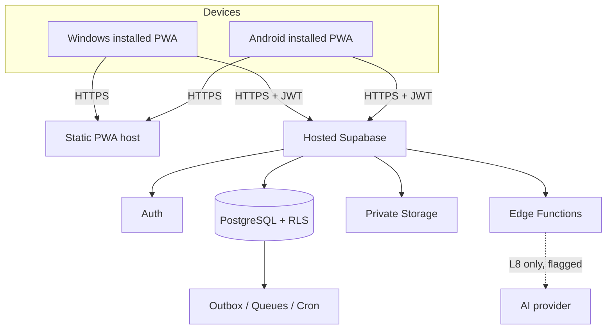

# Architecture

Explains structure; rules live in `AGENTS.md`; decisions in `adr/0002`-`0005`. Update this file in the same
change as any module, schema, API or runtime change.

## Runtime (MVP, Plan A)

Factory Wi-Fi only needs to reach the internet. Why cloud and not a factory LAN server, and when to
revisit: `adr/0003-installed-pwa-cloud-first-network.md`.

The static PWA deploys to Cloudflare Pages (`pnpm build` → `dist`) and Supabase is the complete backend.
Only `VITE_SUPABASE_URL` and `VITE_SUPABASE_PUBLISHABLE_KEY` are browser configuration; service-role
keys and database passwords remain server-side. See ADR 0006.

## Code layout
`src/app` owns providers, routes and the shell; `src/auth` owns the session listener and sign-in presentation;
`src/pwa` owns install, update and network-status UI;
`src/lib` owns the Supabase client boundary; `src/components/ui` is reserved for shadcn/ui primitives;
future features live in `src/features/<module>`. `supabase/migrations` holds CLI-generated migrations;
`tests/{unit,integration,e2e,fixtures}` separates verification by scope.

## Layers
Screen components -> feature hooks (TanStack Query) -> typed API wrappers in `src/lib` -> Supabase.
Reads are RLS-scoped queries. Writes that change business state go through named commands
(`reserveMaterial`, `issueMaterial`, `recordProductionOutput`, `submitInspection`, `releaseFinishedGoods`,
`verifyPacking`, `confirmDispatch`; brief G4), each atomic, idempotent and audited.

The commercial command chain starts with `create_rfq`, then records feasibility, creates/approves a quotation and
accepts it into a sales order (ADR 0008, ADR 0009). Each command validates its request, locks the changed record,
checks its expected revision and emits the audit event atomically.

## Data
Domains and table sketch: brief G3 (names are not final). Key shapes: company/plant scoping on every row,
versioned BOM/routing/drawings, append-only `stock_ledger_entries`, `lot_genealogy`, `audit_log`,
`domain_outbox`, `idempotency_keys`. The ERD goes into `docs/domain-model.md` when L2 starts.

L1 now defines the authorization root: `companies`, `plants`, `profiles`, `company_memberships`,
`user_company_roles`, role-to-permission mappings and `audit_log`. RLS uses private security-definer helpers;
business tables and transactional commands are added only after this base is applied and integration-tested.

The signed-in Command Center reads company-scoped summary counts and a protected `get_order_command_center` query.
The latter is a read-only, sales-authorized boundary that reports independent commercial, reservation, packing and
dispatch states without relying on browser-side joins or unit-unsafe quantity aggregation.
Global identifier search uses the read-only, `SECURITY INVOKER` `search_company_records` RPC. It returns at most 20
normalized labels and relies on the caller's existing source-table RLS rather than adding a broad search privilege.
Record workspaces use durable browser routes and typed direct reads from those same current, RLS-scoped source tables;
they do not add a record-aggregation API. A result opens only when the caller can already read it. Related records are
individually read through their existing RLS policies, and the audit timeline remains visible only to roles with the
existing `audit.read` permission (ADR 0015).
The master-data setup feature uses small typed browser adapters for single-table, RLS-protected customer, supplier,
item, drawing-header, warehouse, location and work-centre creation; material or stateful transitions remain database
commands.

Finished-goods receipt and QC release are separate stock commands. The receipt creates a held lot and signed ledger
movement; only a Quality-authorized revision-checked release makes it eligible for reservation (ADR 0010).
The Stock workspace calls those commands through typed adapters and reads lot status through RLS; it never writes a
ledger row or QC status directly.
Prepared packing shipments are created atomically from active reservations; dispatch then consumes those exact
reservation lines through the signed ledger (ADR 0011).
Composite foreign keys that carry a `company_id` require a matching parent composite unique key; work-centre
routing operations enforce this database-level tenant boundary (ADR 0004 amendment).
The final command-hardening migration revokes default anonymous execution from every public security-definer
function. Authenticated command calls still perform their own identity, permission, revision and quantity checks.
The browser workspace exposes the commercial command chain, matching-item stock reservation and packed-shipment
dispatch without adding any direct business-table writes. The hosted Playwright suite uses the same browser flow
against a disposable project, including its passwordless sign-in session (ADR 0013).

## Environments
Cloud Supabase is the only required backend environment; no local Docker Supabase setup is required for this MVP.
A separate disposable hosted project or database branch is used for end-to-end verification, never production.
Secrets only in Supabase/GitHub secrets, never in the repo. Region and plan: open questions Q1-Q2.
Hosted setup steps, Auth redirect requirements and Cloudflare Pages build variables are in `docs/deployment.md`.

## Trust boundaries
Browser (untrusted) -> Supabase Auth JWT -> RLS and commands (trusted). Service-role key only inside Edge
Functions. AI provider is a further boundary, absent until L8.

The browser can request a passwordless sign-in link only for an existing approved account; the call disables
automatic user creation. No role, membership or company bootstrap is trusted to browser code (ADR 0007).
The sole setup exception is the locked, one-time initial-company bootstrap command, which creates the first
company, plant and caller administrator membership atomically (ADR 0012).
