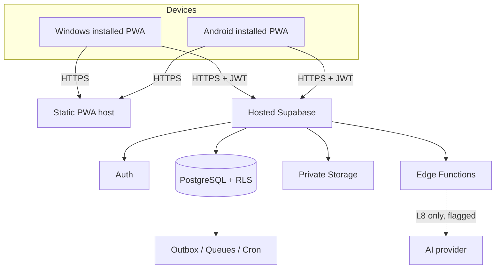

# Architecture

Explains structure; rules live in `AGENTS.md`; decisions in `adr/0002`-`0005`. Update this file in the same
change as any module, schema, API or runtime change.

## Runtime (MVP, Plan A)

Factory Wi-Fi only needs to reach the internet. Why cloud and not a factory LAN server, and when to
revisit: `adr/0003-installed-pwa-cloud-first-network.md`.

The static PWA deploys to Cloudflare Pages (`pnpm build` → `dist`) and Supabase is the complete backend.
Only `VITE_SUPABASE_URL` and `VITE_SUPABASE_PUBLISHABLE_KEY` are browser configuration; service-role
keys and database passwords remain server-side. See ADR 0006.

## Code layout
`src/app` owns providers, routes and the shell; `src/auth` owns the session listener and sign-in presentation;
`src/pwa` owns install, update and network-status UI;
`src/lib` owns the Supabase client boundary; `src/components/ui` is reserved for shadcn/ui primitives;
future features live in `src/features/<module>`. `supabase/migrations` holds CLI-generated migrations;
`tests/{unit,integration,e2e,fixtures}` separates verification by scope.

## Layers
Screen components -> feature hooks (TanStack Query) -> typed API wrappers in `src/lib` -> Supabase.
Reads are RLS-scoped queries. Writes that change business state go through named commands
(`reserveMaterial`, `issueMaterial`, `recordProductionOutput`, `submitInspection`, `releaseFinishedGoods`,
`verifyPacking`, `confirmDispatch`; brief G4), each atomic, idempotent and audited.

The commercial command chain starts with `create_rfq`, then records feasibility, creates/approves a quotation and
accepts it into a sales order (ADR 0008, ADR 0009). Each command validates its request, locks the changed record,
checks its expected revision and emits the audit event atomically.

## Data
Domains and table sketch: brief G3 (names are not final). Key shapes: company/plant scoping on every row,
versioned BOM/routing/drawings, append-only `stock_ledger_entries`, `lot_genealogy`, `audit_log`,
`domain_outbox`, `idempotency_keys`. The ERD goes into `docs/domain-model.md` when L2 starts.

L1 now defines the authorization root: `companies`, `plants`, `profiles`, `company_memberships`,
`user_company_roles`, role-to-permission mappings and `audit_log`. RLS uses private security-definer helpers;
business tables and transactional commands are added only after this base is applied and integration-tested.

The signed-in Command Center begins with a query hook that reads count-only summaries from RLS-scoped tables;
it displays neither client-side fixtures nor a success state until Supabase returns data.

Finished-goods receipt and QC release are separate stock commands. The receipt creates a held lot and signed ledger
movement; only a Quality-authorized revision-checked release makes it eligible for reservation (ADR 0010).
Prepared packing shipments are created atomically from active reservations; dispatch then consumes those exact
reservation lines through the signed ledger (ADR 0011).

## Environments
Local Supabase (CLI + Docker) for development and migration tests; one hosted project for the pilot.
Secrets only in Supabase/GitHub secrets, never in the repo. Region and plan: open questions Q1-Q2.

## Trust boundaries
Browser (untrusted) -> Supabase Auth JWT -> RLS and commands (trusted). Service-role key only inside Edge
Functions. AI provider is a further boundary, absent until L8.

The browser can request a passwordless sign-in link only for an existing approved account; the call disables
automatic user creation. No role, membership or company bootstrap is trusted to browser code (ADR 0007).
The sole setup exception is the locked, one-time initial-company bootstrap command, which creates the first
company, plant and caller administrator membership atomically (ADR 0012).
