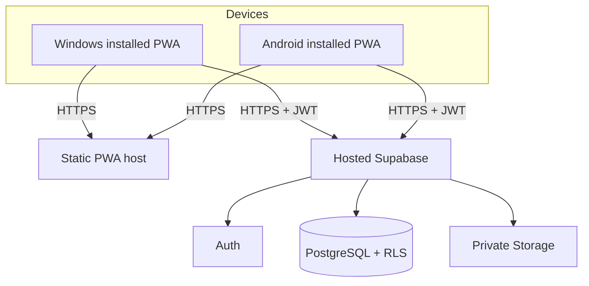
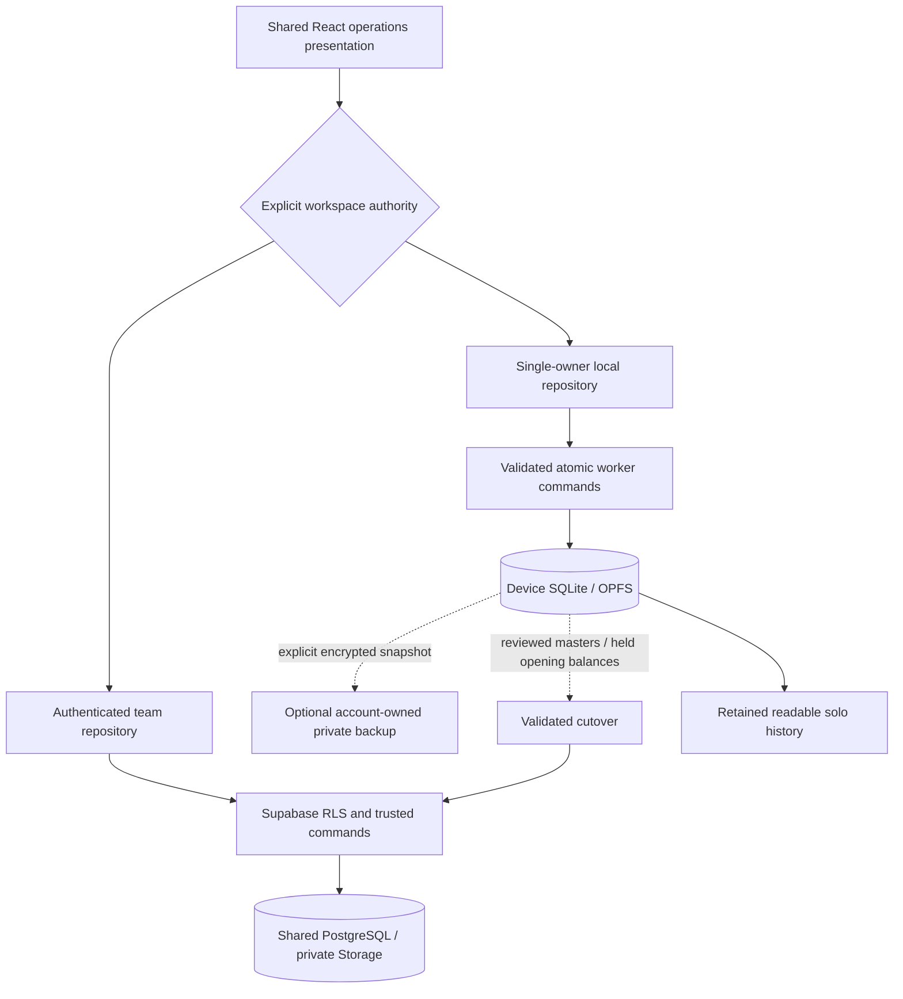

# Architecture

Explains structure; rules live in `AGENTS.md`; decisions live in `adr/`. Module, schema, API and
runtime changes are reconciled here with their implementation.

## Runtime (MVP, Plan A)

Factory Wi-Fi only needs to reach the internet. Why cloud and not a factory LAN server, and when to
revisit: `adr/0003-installed-pwa-cloud-first-network.md`.

The static PWA deploys to Cloudflare Pages (`pnpm build` → `dist`) and Supabase is the complete backend.
Only `VITE_SUPABASE_URL` and `VITE_SUPABASE_PUBLISHABLE_KEY` are browser configuration; service-role
keys and database passwords remain server-side. See ADR 0006.

## Code layout
`src/app` owns providers, routes and the shell; `src/auth` owns the session listener and sign-in presentation;
`src/pwa` owns install, update and network-status UI;
`src/lib` owns the Supabase client boundary; `src/components/ui` is reserved for shadcn/ui primitives;
commercial, procurement, stock, production, quality and dispatch features live in `src/features/<module>`.
`supabase/migrations` holds CLI-generated migrations;
`tests/{unit,integration,e2e,fixtures}` separates verification by scope.

## Layers
Presentational screens receive typed data and actions. Feature hooks own Zod ingress and TanStack Query reads/mutations,
using the client boundary in `src/lib/supabase`. Reads are RLS-scoped queries or SECURITY INVOKER workspace RPCs.
Business transitions use named stock/commercial/material commands or whitelisted `production_command` and
`quality_command` actions; each operation is atomic, idempotent and audited.

The commercial command chain starts with `create_rfq`, then records feasibility, creates/approves a quotation and
accepts it into a sales order (ADR 0008, ADR 0009). Each command validates its request, locks the changed record,
checks its expected revision and emits the audit event atomically.

## Data
Implemented domain structures are described in `docs/domain-model.md`. Key shapes include company/plant scoping,
versioned BOM/routing/drawings, append-only `stock_ledger_entries`, `lot_genealogy`, `audit_log` and idempotency records.
The historical master brief is a proposal, not proof that every table or integration it sketches exists.

L1 now defines the authorization root: `companies`, `plants`, `profiles`, `company_memberships`,
`user_company_roles`, role-to-permission mappings and `audit_log`. RLS uses private security-definer helpers;
business tables and transactional commands are added only after this base is applied and integration-tested.

The signed-in Command Center reads company-scoped summary counts and a protected `get_order_command_center` query.
The latter is a read-only, sales-authorized boundary that reports independent commercial, reservation, packing and
dispatch states without relying on browser-side joins or unit-unsafe quantity aggregation.
Global identifier search uses the read-only, `SECURITY INVOKER` `search_company_records` RPC. It returns at most 20
normalized labels and relies on the caller's existing source-table RLS rather than adding a broad search privilege.
Record workspaces use durable browser routes and typed direct reads from those same current, RLS-scoped source tables;
related-record queries now use the SECURITY INVOKER keyset RPC. A result opens only when the caller can already read it. Related records preserve their existing RLS policies, and the audit timeline remains visible only to roles with the
existing `audit.read` permission (ADR 0015).
The master-data setup feature uses small typed browser adapters for single-table, RLS-protected customer, supplier,
item, drawing-header, warehouse, location and work-centre creation; material or stateful transitions remain database
commands.

Finished-goods receipt and QC release are separate stock commands. The receipt creates a held lot and signed ledger
movement; Quality-authorized release now also requires a passed inspection of the current lot revision and no open
NCR before it becomes eligible for reservation (ADR 0010, ADR 0017).
The Stock workspace calls those commands through typed adapters and reads lot status through RLS; it never writes a
ledger row or QC status directly.
Prepared packing shipments are created atomically from active reservations; dispatch then consumes those exact
reservation lines through the signed ledger (ADR 0011).
Composite foreign keys that carry a `company_id` require a matching parent composite unique key; work-centre
routing operations enforce this database-level tenant boundary (ADR 0004 amendment).
The final command-hardening migration revokes default anonymous execution from every public security-definer
function. Authenticated command calls still perform their own identity, permission, revision and quantity checks.
The browser workspace exposes the commercial command chain, matching-item stock reservation and packed-shipment
dispatch without adding any direct business-table writes. The hosted Playwright suite uses the same browser flow
against a disposable project, including its passwordless sign-in session (ADR 0013).

## Environments
Cloud Supabase is the production backend. Local Docker Supabase is an optional disposable test environment and is
used by automatic CI to apply migrations and run SQL/browser assertions without cloud credentials.
A separate disposable hosted project or database branch is used for end-to-end verification, never production.
Secrets only in Supabase/GitHub secrets, never in the repo. Region and plan: open questions Q1-Q2.
Hosted setup steps, Auth redirect requirements and Cloudflare Pages build variables are in `docs/deployment.md`.

## Trust boundaries
Browser (untrusted) -> Supabase Auth JWT -> RLS and commands (trusted). Test fixture provisioning keeps service-role
credentials in the runner; future runtime privileged integrations belong behind Edge Functions. Core workflows are
deterministic and derive quantities, transitions and quality results in trusted database commands.

## Commercial and materials implementation (ADR 0016)

`CommercialInbox` and `CommercialWorkflowPanel` receive typed data/actions; `useCommercialDetail` and existing hooks
own RLS-scoped reads. `CommandFeedback`, `RevisionSummary` and `StockBalanceSummary` are shared presentation components. The material
slice lives in `src/features/procurement`; a discriminated command schema accepts only the eight named material APIs.
`ProcurementPanel`, `MaterialDetailsPanel`, `StockExplorerPanel` and `StockReviewPanel` receive typed props and never
perform network I/O. AppShell composes those adapters and queries. A failed material request retains its retry key;
the database binds that key to the request fingerprint before returning a prior confirmation.

`purchase_requisitions`, `purchase_orders`, `goods_receipts`, `goods_returns` and `stock_count_proposals` are tenant-scoped
tables with SELECT-only authenticated grants. Command preflight/finalization helpers live in `private`, with no
authenticated execution grant. Public commands explicitly revoke default PUBLIC/anon execution. Permissions for
purchase read/manage/approve, stock return/count/adjust live in protected role mappings, and require active membership.
`get_my_company_permissions` is a SECURITY INVOKER read for action presentation, not an authorization substitute.
Stores can read sales lines to select demand for their existing reservation permission.

`stock_positions` derives outstanding reservations as quantity minus consumed quantity and reports zero ATP on held
or rejected lots. `purchase_order_positions` derives net receipts and outstanding demand after returns.
`reservation_positions` derives remaining quantity. All views use SECURITY INVOKER; exact numeric reads are cast to
text before transport. No client float calculation controls stock or money. The service worker caches assets only;
business query data remains in memory and is cleared when authenticated identity changes.

Private Storage, controlled drawing/certificate files, vendor custody and split/merge genealogy are implemented. Realtime channels, Edge Functions and queues are not deployed runtime modules; none is necessary for these deterministic commands.

## Production and quality implementation (ADR 0017)

`src/features/production/useProductionWorkspace.ts` exposes the typed `get_production_workspace` read and
`production_command` mutation; `ProductionPanel` renders engineering, demand, shop-floor, material and output views.
`src/features/quality/useQualityWorkspace.ts` owns the typed `get_quality_workspace` read and `quality_command`
mutation; `QualityPanel` renders approved plans, measurements, NCR disposition and clickable lot-history links.
Presentation components receive props/actions and perform no network I/O. The hooks retain the same retry key after
an uncertain failure, bind it to company/action/payload and invalidate production, quality, stock, procurement,
dispatch and related record queries after server confirmation. Shared feedback and balance components remain reused.

`engineering_packages` links an explicit BOM output basis to component lines and ordered routing operations.
`create_package` creates that engineering draft atomically; `approve_package` validates the saved basis, base units,
active items/work centres and nonempty component/routing definitions before freezing approved revisions.
Existing approved revisions without an output basis remain historical references rather than being guessed into a
production recipe. A new `create_work_order` selects accepted sales-line demand and matching approved engineering,
preserves its drawing/BOM/routing pins, and bounds planning against existing work and unrelated stock commitments.

Production tables are `work_orders`, `job_cards`, `work_order_requirements`, `material_issues`, `material_events`,
`production_outputs` and `lot_genealogy`. Browser grants are SELECT-only with company permission RLS.
Plan/release/close actions require `planning.manage`; job progress/output requires `production.execute`;
material issue/return/consumption requires `stock.issue`; engineering draft/approval uses `master_data.manage`.
Database checks remain authoritative even when the UI hides or disables an action.

`material_issue_positions` derives remaining custody as original issue minus explicit return/consume events.
`production_material_positions` derives consumed quantity, issued WIP, released stores availability and expected PO
receipts independently in each item's recorded base unit. These SECURITY INVOKER views transport NUMERIC values as text.
Issue removes released, unreserved stock from stores into work/job custody. Return posts a positive ledger reversal
and restores the lot to QC hold; consumption accounts for WIP without removing the same stock from stores twice.
The only held-source issue exception is the exact lot authorized for an outstanding routed NCR rework order.

Release creates ordered job cards from the pinned routing; normal work needs material readiness and active centres.
Jobs follow predecessor completion, use explicit incremental good/scrap quantities, and keep incomplete work active.
The last operation and output command check required material consumption. Output creates a new held stock lot,
signed production receipt and genealogy edges from actually consumed material issues. Close checks completed jobs,
accounted materials and reconciled output/scrap quantities. Remaining output lots need release; a fully depleted
source with resolved scrap/rework disposition is checked separately. Incomplete physical work cannot disappear as a close.

Quality tables are `inspection_plans`, `inspections` and `ncrs`, with SELECT-only company permission RLS.
`quality.manage` creates/approves plans, `quality.inspect` records readings, and `quality.review` contains stock and
authorizes NCR disposition. Approved plans are immutable. Characteristic keys, numeric limits/units or expected
attribute values and integer sample count are explicit configured data; no factory acceptance criterion is inferred.
Inspection verifies approved plan/item/context, target revision and exactly the configured samples per characteristic.
The server compares exact numeric/value readings and returns a recorded passed/failed result. Corrections insert a new
inspection linked through `supersedes_id`; original readings and inspector evidence remain available.

NCR creation records an affected quantity and contains the whole lot on QC hold. Scrap uses a bounded unreserved
ledger issue; reinspection leaves the lot held. Supplier-return authorization stays `awaiting_return` until actual
receipt-return events cover the affected quantity. Rework creates an explicitly dated/numbered work order using an
approved self-component recipe and stays `awaiting_rework` until its physical completion checks pass.
`release_stock_lot` refuses unresolved NCRs or a missing/failed/stale latest inspection. Packing and dispatch triggers
lock/recheck the source lot's released state, including lots contained after a reservation or packing was prepared.

The quality read links supplier lot/certificate references, consumed material parents, production children and
shipment references. Those records establish actual event provenance. Subsequent controlled split/merge and private file commands extend it; no exact component allocation percentage or certified factory inspection practice is inferred.
All sample plans, operations and readings are fictional SAMPLE configuration; physical pilot SOP remains discovery.

The browser can request a passwordless sign-in link only for an existing approved account; the call disables
automatic user creation. No role, membership or company bootstrap is trusted to browser code (ADR 0007).
The sole setup exception is the locked, one-time initial-company bootstrap command, which creates the first
company, plant and caller administrator membership atomically (ADR 0012).

## Completed factory modules (reconciled 2026-10-12)

The prior future-slice prose was stale after the owner paused documentation. The implementation is authoritative
for the verified SAMPLE behavior; factory policy is still a proposal. ADR 0017's amendments explain these additions.

| Module | Frontend ownership | Trusted boundaries and stored facts |
|---|---|---|
| Item controls/customer parts | master-data hooks and prop-driven panels | Immutable approved specification/conversion versions, original-input conversion events, customer-part pins |
| Line feasibility/split purchasing | sales/procurement hooks | Current line-review pins and locked remaining requisition allocations |
| Vendor custody/lot transformations | jobwork, quality and stock | Bounded outward/return/loss events, held destinations and preserved genealogy |
| Private documents | production/quality and shared privateFiles | Private factory-evidence bucket, immutable versions/ready metadata, byte hash and size verification |
| Packages/customer returns | dispatch | Recorded lot/package custody, bounded partial shipment and held returns |
| Reports | reports | Server-paginated unit-safe operational reads |
| Administration | administration | Protected membership/role commands, last-admin lock, paged literal-filter audit read |
| Controlled transfer | data-transfer and shared CSV/download helpers | Exact saved import source/preview/apply and immutable approved accounting snapshots |
| Equipment/capacity | equipment | Append-only readiness/assignment events, trusted start/inspection guards, explicit serialized shift allocations |
| Scanner/record history | search/records/stock | Exact SECURITY INVOKER lookup, keyset related links/timeline/ledger; bigint IDs transported as text |

All seven latest migrations through `20261012144905_paged_record_links` were applied to local and hosted SAMPLE;
44 source migration identities match. Applied migrations are immutable. New tables retain company RLS and narrow
command permissions; no role metadata or browser service key is introduced. Administration self-access changes clear
private queries; company/kind/ID keys reset record-page state.

## Delivery and operations (ADR 0018)

Vite's default chunking avoids the earlier custom-chunk runtime cycle. Commercial/production/quality workspaces defer
loading inside the reusable WorkspaceBoundary. `scripts/check-bundle.mjs` checks missing/circular static chunks after
production build. The PWA caches static assets only; offline company-query startup cannot block the shell. Approved
updates require explicit reload confirmation; command writes stay disabled offline.

Runner-only scripts share database fingerprints and encrypted backup format. Nightly configured exports combine a
PostgreSQL archive and private Storage bytes; weekly/PR local restore tests decrypt, restore a temporary DB, compare
records/policies/files and rerun all SQL regressions. These scripts are operations tools, not an application backend.
The read-only production gate verifies schema/Auth/hosting and supplied dated acceptance evidence. Cloudflare headers
ship with the static build. Secrets, retained keys, live schedule activation and physical rollout remain owner setup.
See `docs/deployment.md`; no production deployment is implied by a green SAMPLE gate.

## Owner-decided dual authority (ADR 0019, 2026-10-12)

The target architecture now includes separate solo SQLite and cloud team workspaces. Runtime implementation remains
pending design review; all preceding implemented-module evidence is for the existing cloud path. No SQLite/offline
business feature is claimed by the earlier cloud tests.

Solo requires no cloud account/network for applicable operations. Team keeps server-enforced roles, independent
review and online writes. There is no automatic same-company synchronization. Backup is not team participation;
mode switching never uploads or merges data. Exact arithmetic, immutable pins/events, local commit/rollback,
revision/idempotency checks, versioned schema and validated restore are necessary for local parity.

Owner-approved cutover transfers verified masters/opening balances and retains solo history with device provenance.
Open work/custody/reservations/NCRs must be completed or reconciled; cloud openings are held rather than inheriting
local QC approval. Preserve source until confirmed final import. The detailed implementation/acceptance plan is
`docs/superpowers/specs/2026-10-12-solo-sqlite-and-cloud-team-design.md`, TASK-0017. Existing team data remains intact.
