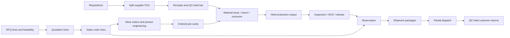

# Domain model

Implemented generic model as of 2026-10-12; all factory process configuration is **DESIGN PROPOSAL** until verified. Rules live in `AGENTS.md`. Approved versions and posted events remain immutable.

## Tenant and commands

Companies/plants scope records. Auth users identify approved accounts; company memberships and protected role mappings authorize actions. Active membership is required by shared permission helpers. Administration commands serialize membership/role changes and protect the last active admin. Audit and idempotency records are append-only. No role is accepted from user metadata.

Presentation receives typed props/actions; feature hooks validate ingress, invoke an atomic command and refresh server truth after confirmation. Browser business-table grants are generally SELECT-only; initial master inserts use existing RLS boundaries. No component writes a multi-table transition.

## Controlled references and commercial data

Items retain base units; approved item specification versions carry fastener type, dimensions with units, thread, grade/class/coating and standard/evidence. Approved measured item-specific alternate-unit versions preserve original quantity/UOM and converted base quantity in append-only conversion events. Fractional discrete units and unrepresentable precision are rejected, never rounded. Quote/order/work lines pin immutable specification IDs.

Drawings own private file-backed revisions; approved BOM/routing/engineering versions freeze definitions and explicit output bases. Customer part/drawing references pin downstream. RFQ-wide legacy and per-line feasibility reviews coexist; quotation lines pin their exact accepted line review/engineering references. Acceptance copies immutable quote pins; it does not resolve a newer master version. Money and measurements use NUMERIC with explicit currency/unit and decimal-text transport.

## Purchasing and stock

Requisition allocation positions derive remaining demand across supplier POs; locked allocation prevents concurrent overpurchase. Approve before partial receiving. Each receipt creates a distinct held lot; returns append bounded signed reversals. Stock positions derive physical, reserved, QC-held and available quantities from the signed ledger and remaining reservations. Expected PO receipts are not available stock.

Counts propose a variance against current server balance/revision; an independent reviewer confirms. Corrections append reversal events. Lot split/merge conserves quantities, preserves source edges and holds destination lots. History uses exact text event IDs and keyset pages, without hidden 100/20-row truncation.

## Production, quality and vendor custody

Work orders bound accepted demand and pin engineering/specifications. Ordered jobs enforce predecessor completion. Material issue removes available stores stock into WIP custody; unused returns restore held stock; consumption does not remove it twice. Outputs link actual consumed parents and enter hold. Close requires reconciled work, materials, output/loss and quality/disposition.

Inspection plans define exact numeric/attribute criteria, units and sample counts. Approved criteria and results are immutable; corrections supersede. Current passed inspection plus resolved containment is required for release. NCR dispositions retain reasons and actual return/rework/scrap completion. Holds are rechecked when packing/dispatch occurs, including previously reserved/packed lots.

Vendor job-work orders record outward custody, partial returns/loss and actual completion; return lots remain inspection-held. Genealogy preserves split/merge/rework/material/output/vendor relationships. Private drawing/certificate metadata, hashes and stored bytes are distinct from evidence references; references alone never imply an uploaded or certified document.

## Equipment and capacity

Equipment assets identify machines/tools/gauges with append-only holds, calibration and configured maintenance evidence. Immutable job assignments can be released while pending. Draft inspection plans bind gauges; approval freezes them. Trusted job-start/inspection guards recheck missing/failed/expired evidence. Unconfigured legacy jobs/plans do not receive invented requirements.

Explicit plant-time work-centre shifts record available minutes after breaks. Minute allocations and releases derive capacity; locks prevent overlapping shifts and concurrent overbooking. No guessed machine rate, throughput, OEE or utilization is stored.

## Dispatch, administration and transfer

Packages identify actual selected lots and bounded quantities. Partial dispatch consumes the exact remaining reservation/stock commitments. Cancelling preparation never erases posted events. Customer returns are bounded against actual shipped quantity and always contain returned stock.

Import previews retain exact source/hash, validation errors and reconciliation; apply revalidates atomically, creates only valid records and never overwrites history. Accounting exports are immutable approved signed-event/currency snapshots, not a general ledger or statutory tax invoice. Reports are paginated and preserve units. Search/scanning/related-record RPCs preserve caller RLS; audit browsing requires audit permission.

Backups contain DB data and private file bytes; server/hosting/Auth delivery settings and secrets are separate operational configuration. See `docs/deployment.md`.
