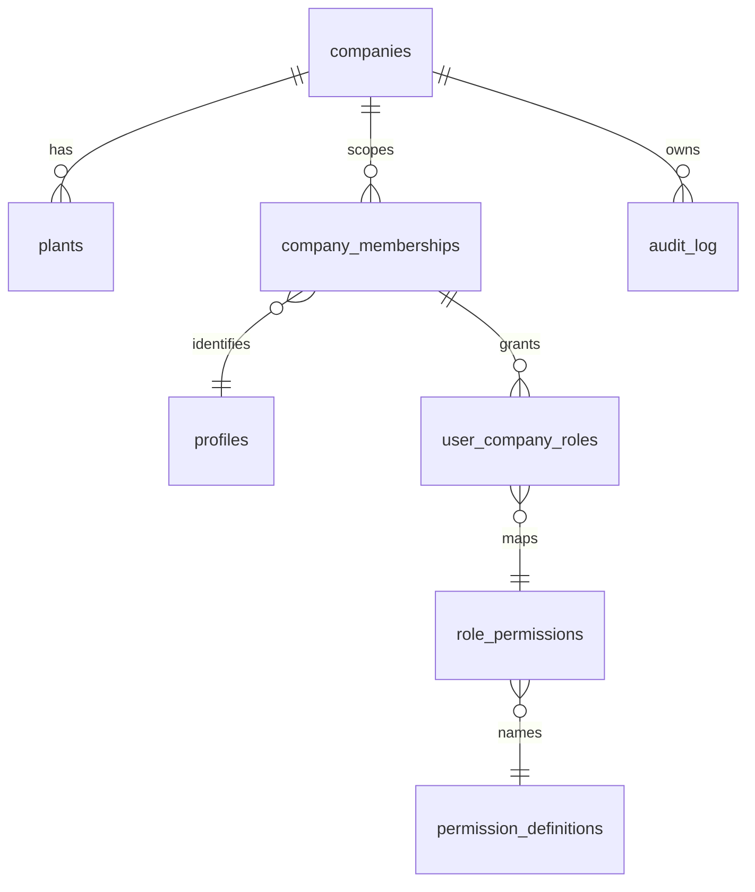

# Domain model

**DESIGN PROPOSAL** — factory workflow entities begin after master-data discovery. This document records the
authorization foundation currently in the migration.

## Tenant access

- `companies` and `plants` are the tenant and plant boundaries.
- `company_memberships` records active tenancy. `user_company_roles` allows one person to have several roles.
- `permission_definitions` and `role_permissions` are protected database facts; user metadata is never authorization.
- `audit_log` is append-only: no authenticated insert/update/delete policy exists. Trusted future commands write it.
- Every future operational table carries `company_id`, enables RLS, indexes its RLS filters, and uses database
  commands for multi-record changes.

## Master data

`customers`, `suppliers`, `items`, `drawings`, `drawing_revisions`, `warehouses`, `stock_locations` and
`work_centres` are all company-scoped. Item, partner, warehouse and work-centre codes are unique inside the
company. A drawing revision belongs to the same company as its drawing and item. Once a revision is approved,
the database rejects every update; a replacement revision must be created instead.

## Engineering versions

`boms` and `routings` select an output item; their revisions are identified by immutable IDs. `bom_lines` keep
component quantity, UOM and scrap allowance as database numerics. `routing_operations` keep ordered work-centre
steps and numeric setup/run minutes. Approved headers reject updates and private draft checks block line/operation
mutation, so later commercial and production records can pin a revision without historical drift.
