# Operator manual

This manual describes the **currently implemented** Fasteners Factory ERP workflow. It uses fictional `SAMPLE`
records only. It is not a verified factory SOP, and it does not replace an approved quality, stores, dispatch, or
commercial procedure.

## Before you start

You need all of the following:

- an administrator-created and approved sign-in account;
- an internet connection for every business-changing action;
- access to at least one company; and
- the relevant database permissions for the action you want to perform.

The first approved user can create the first company and plant. After that, the application shows only companies to
which the signed-in user has access.

## Sign in and orient yourself

1. Open the installed PWA or its approved web address.
2. Enter the email address of an existing approved account and request the passwordless sign-in link.
3. Open that link in the same browser. The workspace appears only after Supabase confirms the session.
4. Choose an **Active company** if the selector offers more than one.

The navigation contains five workspaces:

| Workspace | Use it for |
| --- | --- |
| Command center | See sales, stock, packing, and dispatch state independently for each sales order. |
| Sales orders | Create RFQs and progress them through feasibility, quotation, approval, and sales-order acceptance. |
| Stock | Receive finished goods into a QC hold, release it, and reserve it against an order. |
| Dispatch | Prepare packing/shipment information and make the final dispatch. |
| Master data | Create the reference records used by the other workspaces. |

The global search box sits above the workspace content. Enter at least two characters to search permitted identifiers
and names in the active company.

## First-time company setup

Only do this when the app displays **Set up the first company**.

1. Enter a company name and first plant name.
2. Select **Create company and plant**.
3. Wait for the success confirmation before entering master data.

Behind the scenes, this is a one-time protected command. It creates the company, plant, first administrator
membership, role, and audit event in one transaction. It is deliberately not a normal browser table write and cannot
be repeated once any company exists.

## Create master data in the right order

Open **Master data** and create the records required for an order path. A practical order is:

1. **Customer** — code and name.
2. **Supplier** — code and name. A supplier is not required by the current finished-goods order demo, but is a
   supported master record.
3. **Item** — SKU, description, and base unit of measure.
4. **Drawing** — select the item, then enter its drawing number.
5. **Warehouse** — select the plant, then provide a warehouse code and name.
6. **Stock location** — select the warehouse, then provide a location code and name.
7. **Work centre** — select the plant, then provide a work-centre code and name.

Each form reports either a success message or **Blocked because …**. Do not continue on the basis of a button click;
wait for the result. A record remains company-scoped and is visible only where RLS permits it.

## Complete the current RFQ-to-dispatch workflow

The following is the implemented happy path for existing finished goods. Use `SAMPLE` values while testing.

```mermaid
flowchart LR
  A[Customer and item] --> B[Create RFQ]
  B --> C[Record feasibility]
  C --> D[Create quotation]
  D --> E[Approve quotation]
  E --> F[Create sales order]
  F --> G[Receive lot: QC hold]
  G --> H[Release lot]
  H --> I[Reserve stock]
  I --> J[Prepare shipment]
  J --> K[Dispatch shipment]
```

### 1. Create an RFQ

1. Open **Sales orders**.
2. In **Create RFQ**, enter an RFQ number, select the customer, describe the requirement and requested line, then
   enter a positive quantity and unit.
3. Select **Create RFQ**.

What happens behind the scenes: the protected `create_rfq` command creates an RFQ and its initial requested line
together. The server checks the authenticated company, customer, number, and requested quantity, and records an
idempotency key so a duplicate submission cannot create a second effect.

### 2. Record feasibility

1. In **Commercial workflow**, select the new RFQ under **Record feasibility**.
2. Choose the result. Add conditions or approved drawing/BOM/routing revisions when they exist.
3. Select **Record feasibility**.

Only RFQs waiting for review appear here. The command checks the RFQ’s current revision and changes its commercial
state only if that exact record is still eligible.

### 3. Create and approve a quotation

1. Under **Create quotation**, select the qualified RFQ.
2. Enter a quotation number, select the sellable item, and enter a positive quantity and unit price. Select matching
   approved BOM/routing revisions when available.
3. Select **Create quotation**. It appears as a draft.
4. Under **Approve quotation**, select that draft and select **Approve quotation**.

The quotation is not an order. Approval is a separate protected transition, so the database can reject it if the
caller lacks permission or the quotation changed after the page loaded.

### 4. Create the sales order

1. Under **Accept into sales order**, select the approved quotation.
2. Enter the sales-order number and customer PO number.
3. Select **Create sales order**.

The new sales-order line pins the selected approved engineering revision IDs. Later revision changes do not silently
rewrite the history of that order.

### 5. Receive finished goods into QC hold

1. Open **Stock**.
2. Under **Receive finished goods**, select the item and physical stock location.
3. Enter a unique lot code and positive quantity, then select **Record receipt**.

The lot is intentionally created in **QC hold**. It is not available for reservation yet. The server posts the
receipt as an append-only stock-ledger movement instead of updating a mutable “on hand” number.

### 6. Release the held lot

1. Under **Release held lot**, select the QC-held lot.
2. Select **Release for reservation**.

The release command checks the lot revision and Quality permission. Once confirmed, the matching released lot can
be selected for an open sales-order line.

### 7. Reserve stock

1. Under **Reserve released lot**, select the sales-order line.
2. Select a released lot for the same item.
3. Enter a positive quantity no greater than the available quantity and select **Reserve stock**.

The database locks and checks the order and lot, rejects negative/oversold availability, and creates an active
reservation. If another operator has changed the order or consumed the stock first, refresh and use the displayed
reason to correct the selection.

### 8. Prepare and dispatch the shipment

1. Open **Dispatch**.
2. Under **Prepare packed shipment**, select the open sales order and an active reservation.
3. Enter a packing number, shipment number, and packed quantity, then select **Prepare shipment**.
4. Under **Dispatch shipment**, select the prepared shipment and select **Dispatch shipment**.

Preparing a shipment consumes only the selected active reservation. Final dispatch creates the dispatch state and
the corresponding signed stock-ledger movement together. Repeating the same confirmed request is idempotent: it
does not post a second stock reduction.

## Use the Order Command Center

Open **Command center** to see each sales order’s:

- sales status;
- stock status and active reservation count;
- packing/dispatch status and prepared/dispatched shipment count; and
- next confirmed action.

This view intentionally does not collapse the workflow into a single status. An order can be commercially open while
awaiting stock, reserved while not packed, or packed while not dispatched.

## Understand messages, failures, and retries

Success is shown only after the server confirms the command. A warning begins **Blocked because …** and gives the
operator-facing reason. Typical reasons include:

| Message | Meaning | What to do |
| --- | --- | --- |
| `INSUFFICIENT_AVAILABLE_STOCK` | The requested reservation exceeds current released availability. | Refresh, reduce the quantity, select another released lot, or receive/release more stock. |
| `LOT_QC_HOLD` | The selected lot is still held by QC. | Complete the authorized release before reserving it. |
| `INVALID_TRANSITION` | The record is not in the required state for this step. | Check the prior workflow step and choose an eligible record. |
| `REVISION_CONFLICT` | Another user changed the record while this page was open. | Refresh, review the current data, and submit again if still appropriate. |
| `FORBIDDEN` | The account does not have the required permission. | Ask an administrator to review the company role; do not share accounts. |

Never retry by editing historical ledger or audit rows. Corrections belong in a new approved reversal or follow-up
business action, not in an overwrite.

## Connectivity and offline behavior

The app is cloud-first. When the device is offline, it may load the installed shell and cached read-only screens.
Critical writes—stock, QC release, commercial approval, job close, and dispatch—remain online-only. They do not
silently queue, and they do not show success until the hosted Supabase command confirms the transaction.

## Current limitations

This release does not yet include MRP, purchase orders/GRN, work orders, job cards, WIP, full inspections/NCR,
subcontracting, tax documents, label printing, scanner/camera hardware, or AI actions. Those are roadmap items, not
hidden features. See [product scope](product.md), [roadmap](roadmap.md), and [open questions](open-questions.md).
